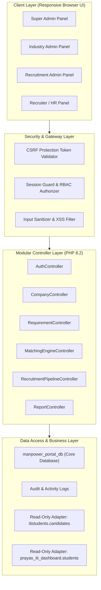

# 04 — System Architecture Specification

## Organization: PRAYAS – The Automation Academy
**Product:** Industry Manpower Requirement Portal  
**Architecture Pattern:** Modular MVC / Role-Based Multi-Tier Architecture  
**Technology Stack:** Core PHP 8.2, MariaDB/MySQL 10.4, PDO, Bootstrap 5.3, Vanilla JS (ES6+)  

---

## 1. High-Level Architectural Diagram

---

## 2. Directory Architecture & Layered Responsibilities

| Directory | Layer | Purpose |
| :--- | :--- | :--- |
| `config/` | Foundation | Single connection PDO factory, application constants, security configuration. |
| `includes/` | Layout & Middleware | Session verification, role guards (`auth_guard.php`), headers, sidebars, navigation bars, modals. |
| `controllers/` | Application Logic | Handling request lifecycle, validating data, performing transactions, rendering views. |
| `models/` | Data Models | Database queries, entity abstractions, matching scoring algorithms. |
| `views/` | Presentation | Clean, responsive Blade/PHP templates separated by user role to avoid leaking UI controls. |
| `api/` | Async Service | JSON endpoints for dynamic dropdowns (districts, trades), instant requirement validation, and AJAX candidate matching. |
| `database/` | Storage & Governance | Idempotent migrations (`database/migrations/`), test seeders, and timestamped backups. |
| `docs/` | Engineering Docs | 14 markdown documents keeping the system fully maintainable and auditable. |

---

## 3. Database Layer Strategy

1. **Isolation of Operational Tables:**
   * All portal tables (`companies`, `users`, `manpower_requirements`, `interviews`, `selections`, `joinings`, etc.) reside in `manpower_portal_db`.
2. **Safe Integration with Candidate Repositories:**
   * An integration layer (`CandidateModel.php`) issues read-only queries joining or aggregating from `itistudents.candidates` and `prayas_iti_dashboard.students`.
   * Stored candidate details (such as screening status, match scores, and interview records) point to candidate references without modifying the source tables.
3. **Connection Pooling & Transactions:**
   * Implemented using PHP PDO with `PDO::ATTR_ERRMODE => PDO::ERRMODE_EXCEPTION` and `PDO::ATTR_DEFAULT_FETCH_MODE => PDO::FETCH_ASSOC`.
   * Multi-table updates (e.g. creating requirement with associated trade tags) run inside `beginTransaction()` / `commit()`.

