# 06 — Entity-Relationship (ER) Architecture & Relational Design

## Document Identifier: ERD-PRA-2026-V2.0
**Project Title:** Industry Manpower Requirement & ITI Candidate Recruitment Portal  
**Organization:** PRAYAS – The Automation Academy  
**Database Name:** `manpower_portal_db` (with Read-Only Bridges)  
**Date:** 2026-11-05  

---

## 1. Complete Entity-Relationship Diagram

```mermaid
erDiagram
    COMPANIES ||--o{ USERS : "employs (1:N)"
    COMPANIES ||--o{ MANPOWER_REQUIREMENTS : "submits (1:N)"
    ROLES ||--o{ USERS : "assigned_to (1:N)"
    ROLES ||--o{ ROLE_PERMISSIONS : "defines (1:N)"
    PERMISSIONS ||--o{ ROLE_PERMISSIONS : "mapped_in (1:N)"

    MANPOWER_REQUIREMENTS ||--o{ REQUIREMENT_TRADES : "specifies (1:N)"
    MANPOWER_REQUIREMENTS ||--o{ REQUIREMENT_SKILLS : "requires (1:N)"
    MANPOWER_REQUIREMENTS ||--o{ REQUIREMENT_STATUS_HISTORY : "tracks (1:N)"
    MANPOWER_REQUIREMENTS ||--o{ CANDIDATE_MATCHES : "sources (1:N)"
    
    EXTERNAL_ITI_CANDIDATES ||--o{ CANDIDATE_MATCHES : "referenced_by (1:N Read-Only)"

    CANDIDATE_MATCHES ||--o{ CANDIDATE_SCREENING : "screened_by (1:N)"
    CANDIDATE_MATCHES ||--o{ INTERVIEWS : "scheduled_for (1:N)"
    INTERVIEWS ||--o{ INTERVIEW_FEEDBACK : "evaluated_with (1:N)"
    
    CANDIDATE_MATCHES ||--o| SELECTIONS : "results_in (1:1 opt)"
    SELECTIONS ||--o| OFFER_LETTERS : "issues (1:1 opt)"
    SELECTIONS ||--o| JOININGS : "culminates_in (1:1 opt)"

    USERS ||--o{ AUDIT_LOGS : "generates (1:N)"
    USERS ||--o{ NOTIFICATIONS : "receives (1:N)"

    COMPANIES {
        int id PK "Auto Increment"
        string company_name "NOT NULL"
        string registration_number UK "Unique CIN/GST"
        string industry_type "Sector"
        text address "Plant/Office"
        string state "State"
        string district "District"
        string city "City"
        string pincode "6 Digits"
        string hr_contact_name "HR Lead"
        string hr_contact_phone "10 Digits"
        string hr_contact_email UK "Official Email"
        enum verification_status "Pending, Verified, Rejected, Suspended"
        int verified_by FK "Super Admin ID (opt)"
        datetime verified_at "Verification Timestamp (opt)"
        text rejection_reason "Reason if rejected (opt)"
        timestamp created_at "Created Timestamp"
        timestamp updated_at "Updated Timestamp"
    }

    USERS {
        int id PK "Auto Increment"
        int role_id FK "References roles.id"
        int company_id FK "References companies.id (NULL for PRAYAS staff)"
        string full_name "User Full Name"
        string email UK "Login Email"
        string phone "Contact Number (opt)"
        string password_hash "BCRYPT Hash"
        enum status "Active, Inactive, Suspended"
        datetime last_login_at "Last Login (opt)"
        timestamp created_at "Created Timestamp"
        timestamp updated_at "Updated Timestamp"
    }

    ROLES {
        int id PK "Auto Increment"
        string name UK "super_admin, industry_admin, recruitment_admin, recruiter"
        string label "Display Label"
        string description "Role Description"
        timestamp created_at "Created Timestamp"
    }

    PERMISSIONS {
        int id PK "Auto Increment"
        string name UK "e.g. requirement.approve"
        string module "e.g. requirements"
        string description "Capability description"
    }

    ROLE_PERMISSIONS {
        int role_id PK,FK "References roles.id"
        int permission_id PK,FK "References permissions.id"
    }

    MANPOWER_REQUIREMENTS {
        int id PK "Auto Increment"
        string requirement_id UK "REQ-YYYYMM-XXXX"
        int company_id FK "References companies.id"
        string title "Requirement Headline"
        int quantity_required "Number of openings >= 1"
        string qualification "ITI Passed, Diploma, Apprentice"
        enum board_type "NCVT, SCVT, Either"
        string passing_year_from "Graduation Year From (opt)"
        string passing_year_to "Graduation Year To (opt)"
        string experience_required "Freshers, 1-2 Yrs, 3+ Yrs"
        string job_location_state "Plant State"
        string job_location_district "Plant District"
        string job_location_city "Plant City"
        text job_description "Detailed Role Description"
        int min_age "Minimum Age >= 18"
        int max_age "Maximum Age (opt)"
        enum gender_preference "Any, Male, Female"
        decimal min_salary "Minimum Monthly CTC > 0"
        decimal max_salary "Maximum Monthly CTC >= min_salary"
        enum salary_type "Monthly, Stipend, Annual"
        enum employment_type "Full Time, Apprenticeship, Fixed Term, OJT"
        string working_hours "Standard shift duration"
        string shift_details "General / Rotational"
        enum accommodation_provided "Yes, No, Subsidized"
        enum food_facility "Yes, No, Subsidized"
        enum transportation_provided "Yes, No, Subsidized"
        enum pf_esic_benefit "Yes, No"
        date submission_date "Submission Date"
        date application_deadline "Application Cutoff"
        date interview_date "Interview Date"
        date target_joining_date "Expected Joining Date"
        enum priority "Low, Medium, High, Urgent"
        enum status "DRAFT, SUBMITTED, UNDER_VALIDATION, NEEDS_CORRECTION, PENDING_REVIEW, APPROVED, RECRUITMENT_IN_PROGRESS, PARTIALLY_FULFILLED, FULFILLED, CLOSED, CANCELLED, REJECTED"
        int approved_by FK "Admin User ID (opt)"
        datetime approved_at "Approval Timestamp (opt)"
        int created_by FK "User ID"
        timestamp created_at "Created Timestamp"
        timestamp updated_at "Updated Timestamp"
    }

    REQUIREMENT_TRADES {
        int id PK "Auto Increment"
        int requirement_id FK "References manpower_requirements.id"
        string trade_name "Electrician, Fitter, Turner, Welder, etc."
        int vacancies "Vacancies for this specific trade"
    }

    REQUIREMENT_SKILLS {
        int id PK "Auto Increment"
        int requirement_id FK "References manpower_requirements.id"
        string skill_name "Required Skill Tag (e.g. PLC, CNC)"
    }

    REQUIREMENT_STATUS_HISTORY {
        int id PK "Auto Increment"
        int requirement_id FK "References manpower_requirements.id"
        string previous_status "Old Status"
        string new_status "Target Status"
        int changed_by FK "User ID"
        text remarks "Reason or audit note (opt)"
        timestamp created_at "Timestamp of change"
    }

    EXTERNAL_ITI_CANDIDATES {
        int id PK "Source Table PK"
        string full_name "Candidate Name"
        string trade "ITI Trade"
        string passing_year "Passing Batch"
        string district "Home District"
        string gender "Gender"
        string status "Active/Verified"
    }

    CANDIDATE_MATCHES {
        int id PK "Auto Increment"
        int requirement_id FK "References manpower_requirements.id"
        enum candidate_source "prayas_dashboard, itistudents"
        int candidate_source_id "PK in source database table"
        string candidate_name "Cached Candidate Name"
        string trade "Cached Candidate Trade"
        string passing_year "Cached Passing Batch (opt)"
        decimal match_score "Score from 0.00 to 100.00"
        text match_details_json "Score breakdown JSON"
        enum status "Matched, Shortlisted, Screened, Scheduled, Selected, Joined, Rejected, On Hold"
        string rejection_reason "Rejection code/reason (opt)"
        timestamp matched_at "Matching Timestamp"
    }

    CANDIDATE_SCREENING {
        int id PK "Auto Increment"
        int match_id FK "References candidate_matches.id"
        int screener_id FK "Recruiter User ID"
        enum screening_outcome "Passed, On Hold, Rejected"
        text screening_notes "Detailed observations"
        timestamp screened_at "Screening Timestamp"
    }

    INTERVIEWS {
        int id PK "Auto Increment"
        int match_id FK "References candidate_matches.id"
        datetime interview_datetime "Date & Time"
        string venue_or_link "Plant Address or Meeting Link"
        string interview_round "Round 1 - Technical, Round 2 - HR"
        string interviewer_name "Plant Technical Lead / Panel"
        enum status "Scheduled, Completed, Cancelled, Rescheduled, No Show"
        int scheduled_by FK "User ID"
        timestamp created_at "Created Timestamp"
    }

    INTERVIEW_FEEDBACK {
        int id PK "Auto Increment"
        int interview_id FK "References interviews.id"
        int technical_rating "Score 1 to 5"
        int practical_rating "Score 1 to 5"
        int communication_rating "Score 1 to 5"
        int punctuality_rating "Score 1 to 5"
        enum recommendation "Selected, Rejected, On Hold"
        text feedback_comments "Interviewer remarks"
        int submitted_by FK "User ID"
        timestamp submitted_at "Submission Timestamp"
    }

    SELECTIONS {
        int id PK "Auto Increment"
        int match_id FK,UK "1:1 with candidate_matches"
        string offered_designation "e.g. Junior Technician"
        decimal offered_ctc "Final Monthly/Annual CTC"
        date offer_date "Date of Selection"
        date target_joining_date "Agreed Reporting Date"
        enum selection_status "Selected, Offer Accepted, Offer Declined"
        int selected_by FK "User ID"
        timestamp created_at "Created Timestamp"
    }

    OFFER_LETTERS {
        int id PK "Auto Increment"
        int selection_id FK,UK "1:1 with selections"
        string letter_reference_no UK "OFFER-202611-XXXX"
        string document_path "Relative path to PDF"
        date issue_date "Date Issued"
        date validity_date "Offer Expiration Date"
        enum status "Issued, Signed, Expired, Revoked"
        timestamp created_at "Created Timestamp"
    }

    JOININGS {
        int id PK "Auto Increment"
        int selection_id FK,UK "1:1 with selections"
        date actual_joining_date "Confirmed reporting date"
        string plant_reporting_unit "Specific Shop Floor / Plant Unit"
        enum joining_status "Joined, No Show, Withdrawn"
        text onboarding_remarks "HR Remarks (opt)"
        int verified_by FK "Recruiter / Industry Admin User ID"
        timestamp created_at "Created Timestamp"
    }

    NOTIFICATIONS {
        int id PK "Auto Increment"
        int recipient_user_id FK "References users.id"
        string title "Notification Title"
        text message "Notification Body"
        string action_url "Deep link to view (opt)"
        boolean is_read "Default FALSE"
        timestamp created_at "Created Timestamp"
    }

    AUDIT_LOGS {
        int id PK "Auto Increment"
        int user_id FK "References users.id (opt)"
        int company_id FK "References companies.id (opt)"
        string action "Event code (e.g. REQ_AUTO_APPROVED)"
        string ip_address "Client IP Address"
        string user_agent "Client Browser Agent"
        text details_json "Before/After state snapshot"
        timestamp created_at "Immutable Timestamp"
    }
```

---

## 2. Cardinality & Relationship Specification

| Relationship | Cardinality | Parent Entity | Child Entity | Relationship Description | Cascade / Constraint |
| :--- | :---: | :--- | :--- | :--- | :--- |
| **Company Users** | $1 : N$ | `companies` | `users` | A company employs one or more authorized users. | `RESTRICT` on delete |
| **Company Requisitions** | $1 : N$ | `companies` | `manpower_requirements` | A company submits multiple manpower requisitions. | `RESTRICT` on delete |
| **Requisition Trades** | $1 : N$ | `manpower_requirements` | `requirement_trades` | A requisition specifies one or more technical trades. | `CASCADE` on delete |
| **Requisition Skills** | $1 : N$ | `manpower_requirements` | `requirement_skills` | A requisition demands zero or more skill tags. | `CASCADE` on delete |
| **Requisition Status Log** | $1 : N$ | `manpower_requirements` | `requirement_status_history` | History of all status changes. | `CASCADE` on delete |
| **Candidate Sourcing** | $1 : N$ | `manpower_requirements` | `candidate_matches` | Requisition matches against candidate pool. | `CASCADE` on delete |
| **Match Screening** | $1 : N$ | `candidate_matches` | `candidate_screening` | Recruiter reviews and screens candidate. | `CASCADE` on delete |
| **Match Interviews** | $1 : N$ | `candidate_matches` | `interviews` | Candidate scheduled for interview rounds. | `CASCADE` on delete |
| **Interview Evaluation**| $1 : N$ | `interviews` | `interview_feedback` | Evaluation rubric and score sheet. | `CASCADE` on delete |
| **Candidate Selection** | $1 : 1$ (opt)| `candidate_matches` | `selections` | Final selection record per match. | `CASCADE` on delete |
| **Offer Letter** | $1 : 1$ (opt)| `selections` | `offer_letters` | Formal offer document. | `CASCADE` on delete |
| **Candidate Joining** | $1 : 1$ (opt)| `selections` | `joinings` | On-site plant reporting verification. | `CASCADE` on delete |
| **Role Permissions** | $M : N$ | `roles` $\leftrightarrow$ `permissions` | `role_permissions` | Granular permission association. | `CASCADE` on delete |
| **Audit Logs** | $1 : N$ | `users` | `audit_logs` | Immutable audit trail. | `SET NULL` on user deletion |
