# 07 — Comprehensive Development & Implementation Plan

## Organization: PRAYAS – The Automation Academy
**Project:** Industry Manpower Requirement Portal  
**Document Reference:** DOC-PRA-07-V1  
**Phased Implementation Strategy:** 12 Controlled Parts  

---

## 1. Phased Development Roadmap

```mermaid
flowchart LR
    P1[Part 01: Analysis & Foundation] --> P2[Part 02: Architecture & Specs]
    P2 --> P3[Part 03: Database & Migrations]
    P3 --> P4[Part 04: Auth & RBAC]
    P4 --> P5[Part 05: Super Admin Panel]
    P5 --> P6[Part 06: Industry Portal]
    P6 --> P7[Part 07: Requirement Engine]
    P7 --> P8[Part 08: Auto-Validation & Alerts]
    P8 --> P9[Part 09: Candidate Matching]
    P9 --> P10[Part 10: Recruitment Pipeline]
    P10 --> P11[Part 11: Reports & Analytics]
    P11 --> P12[Part 12: QA & Deployment]
```

---

## 2. Part-by-Part Scope & Deliverables

### Part 01: Project Analysis & Safe Development Foundation (CURRENT)
- Full workspace inspection, technology stack confirmation, backup automation, risk matrix, master project tracker, and foundational docs.
- **Milestone:** Foundation established; zero code changes to live modules.

### Part 02: Architectural & Business Rules Specifications
- Elaborating detailed functional specifications, matching scoring algorithms, state machines, and permission hierarchies.

### Part 03: Database Architecture, Migrations & Seeders
- Creation of `manpower_portal_db`. Authoring versioned, idempotent SQL migrations for 16 core and operational tables. Seeding default roles, initial permissions, and Super Admin user.
- PDO database connection manager in `config/database.php`.

### Part 04: Authentication, Session Management & RBAC Middleware
- User registration, login with `password_hash`/`password_verify`, session fixation defense, CSRF token handling, and dynamic role-based redirect guards.

### Part 05: Super Admin Panel
- System dashboard, company verification workflow, user administration, master requirement oversight, system audit logs, and settings.

### Part 06: Industry Admin Portal
- Company dashboard, company profile management, requirement submission view, active requirement tracking, candidate status monitoring.

### Part 07: Manpower Requirement Submission Engine
- Complete multi-step requisition submission form matching PRAYAS industry standards (Trade, NCVT/SCVT, passing year, experience, location, age, gender, salary, benefits, timeline milestones, priority).

### Part 08: Automatic Validation Engine & Notification Dispatch
- Server-side business rule validation engine, auto-approval heuristics, sequential alphanumeric ID generator (`REQ-YYYYMM-XXXX`), and in-app notification triggers.

### Part 09: Candidate Sourcing & Intelligent Matching Engine
- Multi-pool query engine joining `prayas_iti_dashboard` and `itistudents`, computing composite weighted match scores ($0 - 100\%$) and displaying ranked candidate pools.

### Part 10: Complete Recruitment Pipeline (Screening to Joining)
- Recruiter work assignment, candidate screening, interview scheduling (Date, Time, Venue/Link), multi-criteria interview feedback, selection, offer letter issuance, joining verification, and partial fulfillment math.

### Part 11: Reports, Analytics & Executive Dashboards
- Trade-wise demand vs. supply metrics, time-to-hire turnaround metrics, company hiring velocity reports, recruiter performance analytics, CSV/Print export capabilities.

### Part 12: End-to-End System Testing, Security Audit & Deployment Guide
- Integration testing across all 4 roles, CSRF/XSS penetration verification, responsive UI validation across mobile/tablet/desktop, production deployment verification.

