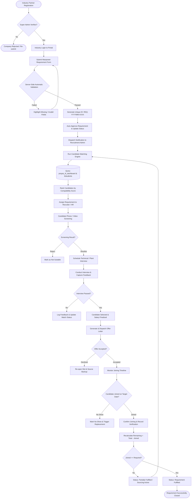
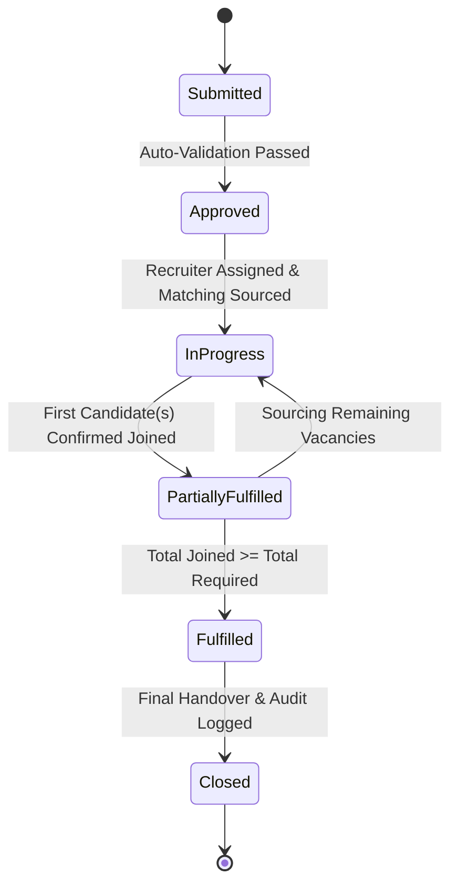

# 07 — Workflow Diagrams

## Organization: PRAYAS – The Automation Academy
**Portal:** Industry Manpower Requirement & Recruitment Portal  

---

## 1. Complete End-to-End Recruitment Workflow

---

## 2. Partial Fulfillment State Machine

