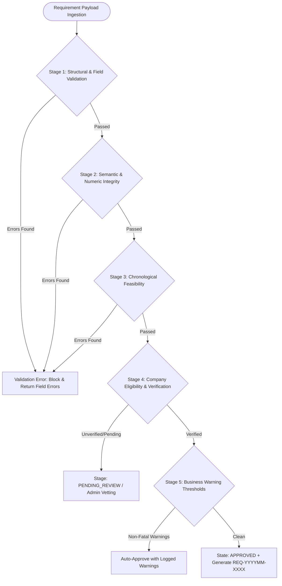

# 16 — Requirement Validation & Auto-Approval Algorithm

## Document Identifier: ALG-VAL-2026-V1.0
**Project Title:** Industry Manpower Requirement & ITI Candidate Recruitment Portal  
**Organization:** PRAYAS – The Automation Academy  
**Date:** 2026-11-05  

---

## 1. Multi-Stage Validation Pipeline

The Manpower Requirement Validation Engine is a deterministic multi-stage filter executed whenever a requisition is submitted or modified by an industrial employer.



---

## 2. Classification of Validation Outcomes

The engine categorizes validation outcomes into four distinct operational severities:

| Severity Level | System Meaning | Operational Behavior | Target State |
| :--- | :--- | :--- | :---: |
| **Validation Error** | Fatal data defect or violation of core constraints (missing mandatory fields, negative headcount, invalid dates). | Abort transaction. Save input as draft revision. Return field-level errors to user. | `NEEDS_CORRECTION` |
| **Warning** | Syntactically valid but economically or logistically unusual (e.g. salary significantly below market, or short turnaround). | Highlight notice to employer, log warning in audit logs, but do NOT block progress. | `APPROVED` (if verified) |
| **Manual Review** | Requisition requires human administrative vetting (e.g. new company profile, urgent high-volume requisition $> 50$ technicians). | Forward requisition to Super Admin queue for commercial signoff. | `PENDING_REVIEW` |
| **Automatic Approval** | All mandatory fields valid, numeric rules satisfied, timeline feasible, employer verified. | Instantly approve requisition, issue `REQ-YYYYMM-XXXX`, alert recruitment desk. | `APPROVED` |

---

## 3. Detailed Parameter Validation Matrix

### 3.1 Structural & Mandatory Field Checks (Stage 1)
| Parameter | Rule & Regex | Error Code | Failure Message |
| :--- | :--- | :--- | :--- |
| `title` | Length $\ge 5$ and $\le 255$ chars | `ERR-TIT-01` | "Requirement title must be between 5 and 255 characters." |
| `quantity_required` | Integer $> 0$ and $\le 500$ | `ERR-QTY-01` | "Quantity must be a positive integer between 1 and 500." |
| `trades` | Array with `count >= 1`; each trade exists in ITI master | `ERR-TRD-01` | "At least one valid ITI trade must be selected." |
| `qualification` | String in `['ITI Passed', 'Diploma', 'Apprentice']` | `ERR-QLF-01` | "Please select a valid qualification level." |
| `board_type` | Enum in `['NCVT', 'SCVT', 'Either']` | `ERR-BRD-01` | "Please specify NCVT, SCVT, or Either." |
| `job_description` | Length $\ge 20$ chars | `ERR-DSC-01` | "Job description must contain at least 20 characters." |

### 3.2 Semantic & Compensation Checks (Stage 2)
| Parameter | Rule Formulation | Error Code | Failure Message |
| :--- | :--- | :--- | :--- |
| `min_salary` | Numeric $> 0$ | `ERR-SAL-01` | "Minimum salary must be greater than zero." |
| `max_salary` | Numeric $\ge \text{min\_salary}$ | `ERR-SAL-02` | "Maximum salary cannot be less than minimum salary." |
| `min_salary` Warning | If $\text{min\_salary} < 12,000\text{ INR}$ | `WARN-SAL-01` | *(Warning)* "Salary is below average technician benchmark." |
| `salary_type` | Enum in `['Monthly', 'Stipend', 'Annual']` | `ERR-SAL-03` | "Invalid salary frequency type." |
| `employment_type` | Enum in `['Full Time', 'Apprenticeship', 'Fixed Term', 'OJT']`| `ERR-EMP-01` | "Please select a valid employment type." |

### 3.3 Chronological Timeline Checks (Stage 3)
Let $D_{\text{today}}$ be today's date, $D_{\text{deadline}}$ be application deadline, $D_{\text{interview}}$ be interview date, and $D_{\text{joining}}$ be target joining date.

$$\text{TimelineFeasible} = (D_{\text{today}} \le D_{\text{deadline}}) \land (D_{\text{deadline}} \le D_{\text{interview}}) \land (D_{\text{interview}} \le D_{\text{joining}})$$

| Constraint Check | Condition | Severity | Error / Action |
| :--- | :--- | :---: | :--- |
| **Past Deadline** | $D_{\text{deadline}} < D_{\text{today}}$ | **Error** | "Application deadline cannot be in the past." (`ERR-DAT-01`) |
| **Premature Interview** | $D_{\text{interview}} < D_{\text{deadline}}$ | **Error** | "Interview date must occur on or after application deadline." (`ERR-DAT-02`) |
| **Premature Joining** | $D_{\text{joining}} < D_{\text{interview}}$ | **Error** | "Target joining date must occur after the interview date." (`ERR-DAT-03`) |
| **Turnaround Warning** | $D_{\text{joining}} - D_{\text{today}} < 7 \text{ days}$ | **Warning** | "Turnaround is under 7 days; expedited sourcing applied." (`WARN-DAT-01`) |

### 3.4 Geographic & Demographic Checks (Stage 4)
- **Job Location:** `job_location_state`, `job_location_district`, and `job_location_city` must be non-empty strings.
- **Age Criteria:**
  - $\text{min\_age} \ge 18$ (Strict statutory compliance with Factories Act).
  - If $\text{max\_age}$ is set, $\text{max\_age} \ge \text{min\_age}$. If $\text{max\_age} > 60$, trigger error `ERR-AGE-02`.
- **Gender Preference:**
  - Enum in `['Any', 'Male', 'Female']`.
  - If `Female` is selected for plant requiring night shifts without transport, trigger **Manual Review** flag for safety compliance.

---

## 4. Automatic Approval Decision Logic

```php
function evaluateRequirementApproval(Requirement $req, Company $company): ValidationResult {
    $errors = [];
    $warnings = [];

    // Stage 1: Structural & Field Checks
    if (empty($req->title) || strlen($req->title) < 5) $errors['title'] = "Title must be at least 5 chars.";
    if ($req->quantity_required < 1) $errors['quantity'] = "Min 1 candidate required.";
    if (empty($req->trades)) $errors['trades'] = "At least one trade must be selected.";

    // Stage 2: Compensation Checks
    if ($req->min_salary <= 0) $errors['min_salary'] = "Salary must be positive.";
    if ($req->max_salary < $req->min_salary) $errors['max_salary'] = "Max salary cannot be less than min salary.";

    // Stage 3: Chronological Checks
    $t_today = strtotime(date('Y-m-d'));
    $t_dead = strtotime($req->application_deadline);
    $t_int = strtotime($req->interview_date);
    $t_join = strtotime($req->target_joining_date);

    if ($t_dead < $t_today) $errors['deadline'] = "Deadline cannot be in past.";
    if ($t_int < $t_dead) $errors['interview'] = "Interview date must be on or after deadline.";
    if ($t_join < $t_int) $errors['joining'] = "Joining date must be on or after interview.";

    // Failure Path
    if (!empty($errors)) {
        return new ValidationResult(status: 'NEEDS_CORRECTION', errors: $errors);
    }

    // Company Status Gate
    if ($company->verification_status !== 'Verified') {
        return new ValidationResult(status: 'PENDING_REVIEW', message: "Company pending verification.");
    }

    // Large Requisition Gate (> 50 candidates triggers commercial review)
    if ($req->quantity_required > 50) {
        return new ValidationResult(status: 'PENDING_REVIEW', message: "High-volume order routed for allocation review.");
    }

    // Auto-Approval Success Path
    return new ValidationResult(status: 'APPROVED', auto_approved: true);
}
```

---

## 5. Requirement ID Generation Algorithm

When a requirement is marked `APPROVED`, the unique ID is generated atomically:

$$\text{ID} = \text{REQ} - \text{YYYYMM} - \text{LPAD}(\text{MonthlySeq}, 4, \text{'0'})$$

### Generation Steps:
1. Inquire the database sequence for the current year-month (`YYYYMM`):
   ```sql
   SELECT COUNT(*) + 1 AS seq_no 
   FROM manpower_requirements 
   WHERE requirement_id LIKE CONCAT('REQ-', :year_month, '-%')
   FOR UPDATE;
   ```
2. Format the 4-digit zero-padded sequence integer (e.g. `1` becomes `0001`).
3. Formulate the composite string (e.g. `REQ-202611-0001`).
4. Assign to `manpower_requirements.requirement_id` inside the active transaction.

