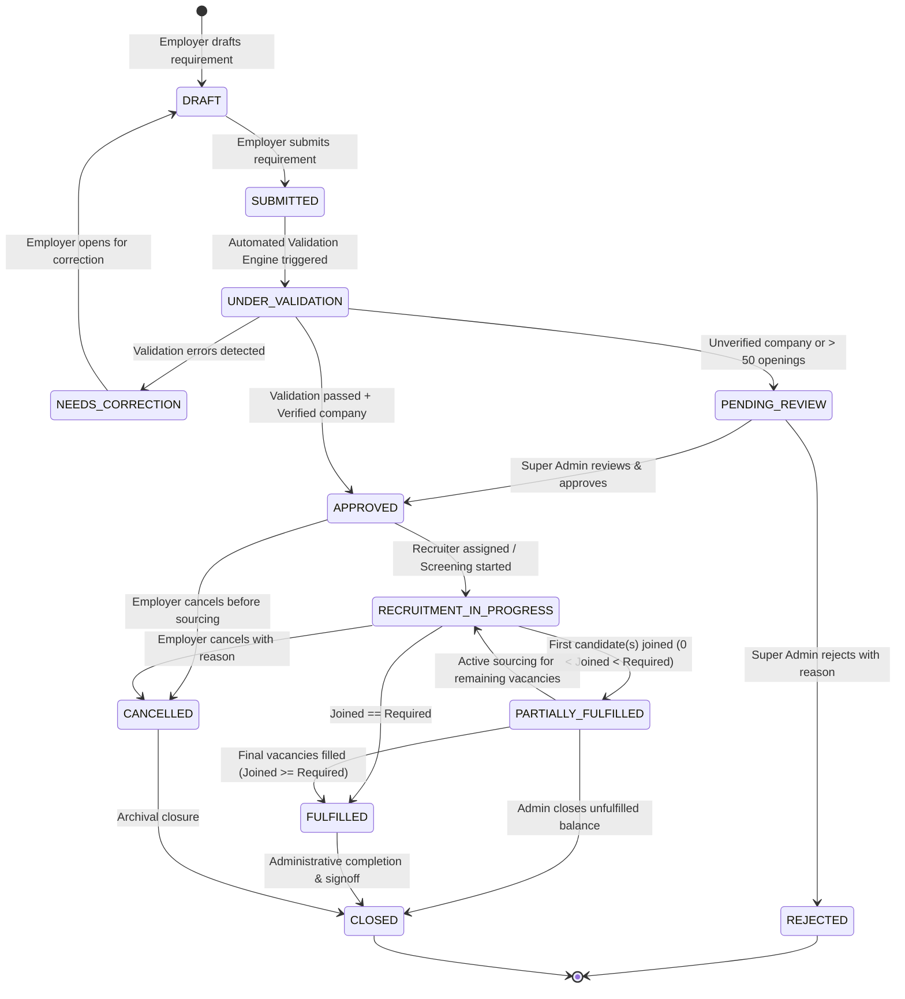

# 17 — Requirement State Machine & Lifecycle Governance

## Document Identifier: FSM-REQ-2026-V1.0
**Project Title:** Industry Manpower Requirement & ITI Candidate Recruitment Portal  
**Organization:** PRAYAS – The Automation Academy  
**State Machine Type:** Deterministic Finite State Automaton (DFA)  
**Date:** 2026-11-05  

---

## 1. Requirement Lifecycle State Diagram



---

## 2. Complete State Catalog

| State Identifier | Human-Readable Name | Description | Sourcing Active? |
| :--- | :--- | :--- | :---: |
| `DRAFT` | Draft | Saved by Industry Admin; not yet evaluated by validation engine. | No |
| `SUBMITTED` | Submitted | Formal submission initiated; queued for immediate validation. | No |
| `UNDER_VALIDATION`| Under Validation | System actively verifying structural, compensation, and date rules. | No |
| `NEEDS_CORRECTION`| Needs Correction | Requisition contains errors; returned to employer with actionable flags. | No |
| `PENDING_REVIEW` | Pending Review | Awaiting human administrative approval (e.g. high volume or new firm). | No |
| `APPROVED` | Approved | Compliant order; assigned unique `REQ-YYYYMM-XXXX`; ready for sourcing. | Ready |
| `RECRUITMENT_IN_PROGRESS` | In Progress | Recruiter assigned; candidate matching, screening, interviews underway. | **YES** |
| `PARTIALLY_FULFILLED` | Partially Fulfilled | Some candidates confirmed joined ($0 < \text{Joined} < \text{Required}$). | **YES** |
| `FULFILLED` | Fulfilled | Target openings met ($\text{Joined} \ge \text{Required}$). | Completed |
| `CLOSED` | Closed | Archived after reconciliation or formal handover. | Archived |
| `CANCELLED` | Cancelled | Withdrawn by employer before full completion. | Terminated |
| `REJECTED` | Rejected | Vetoed by Super Admin with recorded justification. | Terminated |

---

## 3. State Transition Matrix & Authority Matrix

| From State | To State | Trigger / Event | Authorized Roles | Transition Conditions | Notifications Triggered | Audit Log Action |
| :--- | :--- | :--- | :--- | :--- | :--- | :--- |
| `DRAFT` | `SUBMITTED` | Submit button clicked | `industry_admin`, `super_admin` | Form inputs passed client validation | Industry Admin | `REQ_SUBMITTED` |
| `SUBMITTED` | `UNDER_VALIDATION` | Engine hook | `SYSTEM` | Immediate execution | None | `REQ_VALIDATION_START` |
| `UNDER_VALIDATION` | `NEEDS_CORRECTION` | Validation fails | `SYSTEM` | $\ge 1$ Validation error present | Industry Admin | `REQ_VALIDATION_FAILED` |
| `NEEDS_CORRECTION` | `DRAFT` | Edit initiated | `industry_admin` | Correcting input | None | `REQ_EDIT_START` |
| `UNDER_VALIDATION` | `PENDING_REVIEW` | Gate threshold | `SYSTEM` | Company unverified OR $Q > 50$ | Super Admin, Recruitment Admin | `REQ_ROUTE_REVIEW` |
| `UNDER_VALIDATION` | `APPROVED` | Auto-approval | `SYSTEM` | Errors $= 0$, Verified, $Q \le 50$ | Recruitment Admin, Industry | `REQ_AUTO_APPROVED` |
| `PENDING_REVIEW` | `APPROVED` | Manual approval | `super_admin`, `recruitment_admin` | Commercial vetting confirmed | Industry Admin, Recruitment | `REQ_MANUAL_APPROVED` |
| `PENDING_REVIEW` | `REJECTED` | Manual rejection | `super_admin` | Rejection reason $\ge 15$ chars | Industry Admin | `REQ_REJECTED` |
| `APPROVED` | `RECRUITMENT_IN_PROGRESS` | Sourcing starts | `recruitment_admin`, `recruiter` | Recruiter assigned, matching run | Recruiter, Industry Admin | `REQ_SOURCING_STARTED` |
| `RECRUITMENT_IN_PROGRESS` | `PARTIALLY_FULFILLED` | Joining recorded | `recruiter`, `super_admin` | $0 < \text{Joined} < \text{Required}$ | Industry Admin, Rec Admin | `REQ_PARTIALLY_FULFILLED`|
| `PARTIALLY_FULFILLED` | `FULFILLED` | Final joining recorded | `recruiter`, `super_admin` | $\text{Joined} \ge \text{Required}$ | Industry Admin, All Admins | `REQ_FULFILLED` |
| `RECRUITMENT_IN_PROGRESS` | `FULFILLED` | Batch joinings recorded | `recruiter`, `super_admin` | $\text{Joined} \ge \text{Required}$ in batch | Industry Admin, All Admins | `REQ_FULFILLED` |
| `APPROVED` | `CANCELLED` | Cancellation | `industry_admin`, `super_admin` | Reason entered, no joined cands | Recruitment Admin | `REQ_CANCELLED` |
| `RECRUITMENT_IN_PROGRESS` | `CANCELLED` | Cancellation | `industry_admin`, `super_admin` | Commercial cancellation agreement | Recruiter, Recruitment Admin | `REQ_CANCELLED` |
| `PARTIALLY_FULFILLED` | `CLOSED` | Balance closure | `super_admin`, `recruitment_admin` | Unfilled balance waived | Industry Admin | `REQ_CLOSED_PARTIAL` |
| `FULFILLED` | `CLOSED` | Final archiving | `super_admin`, `recruitment_admin` | All onboarding audits cleared | Industry Admin | `REQ_CLOSED_FINAL` |

---

## 4. Invalid Transition Handling

If any user or API client attempts an illegal state transition (e.g. attempting to jump from `DRAFT` directly to `APPROVED` or from `REJECTED` to `FULFILLED`):
1. **Immediate Execution Abort:** The transition request is rejected immediately with an HTTP 422 Unprocessable Entity or 403 Forbidden.
2. **Deterministic Error Response:**
   ```json
   {
     "status": "error",
     "code": "ILLEGAL_STATE_TRANSITION",
     "message": "Cannot transition requirement from current state 'REJECTED' to 'FULFILLED'. Valid target states are: None.",
     "current_state": "REJECTED"
   }
   ```
3. **Security Audit Log Entry:** A security alert is recorded in `audit_logs` capturing `user_id`, `attempted_transition`, `ip_address`, and `user_agent`.

