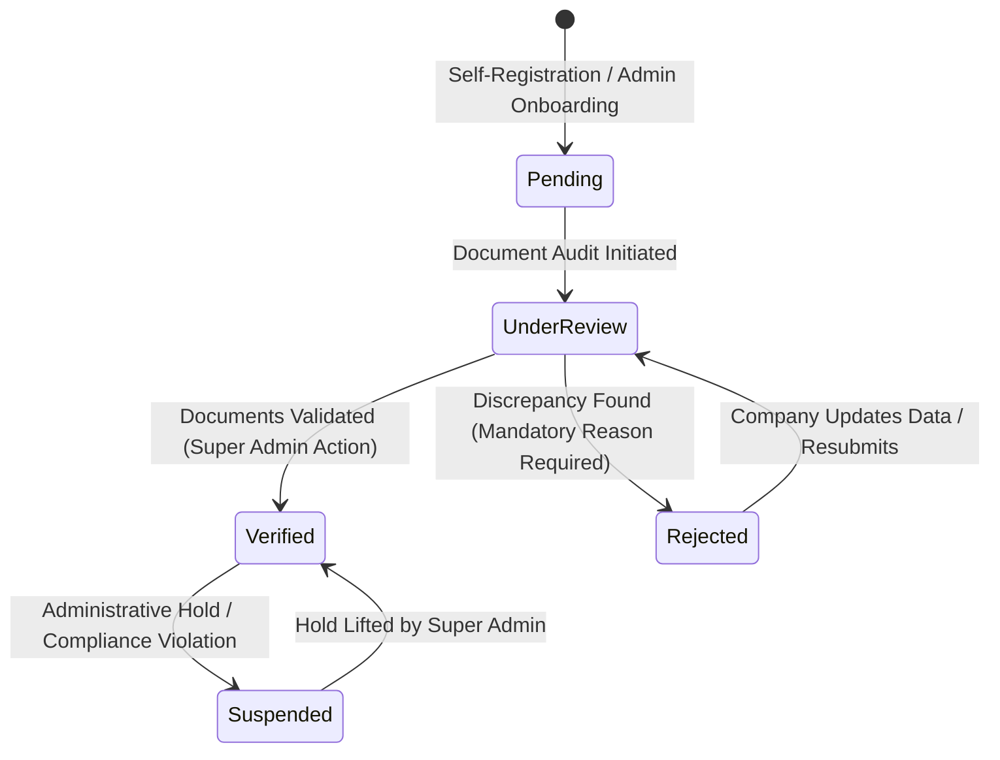

# 24 — Industry Company Management & Verification Workflow

**Project:** Industry Manpower Requirement Portal  
**Organization:** PRAYAS – The Automation Academy  
**Component:** Company Lifecycle & Verification Module  
**Document ID:** DOC-COM-24  
**Status:** Approved & Implemented  

---

## 1. Overview & Objectives

The **Company Management Module** (`controllers/CompanyController.php`, `views/super_admin/companies.php`, `company_details.php`, `company_form.php`) manages the lifecycle of industry employers partnering with PRAYAS – The Automation Academy.

It governs the entire lifecycle:
1. Enterprise Registration / Onboarding
2. Verification Review & Due Diligence
3. Document Inspection (CIN, GSTIN, PAN, Plant Addresses)
4. Approval, Rejection (with recorded reason), or Suspension
5. Requisition Tracking & User Affiliation

---

## 2. Verification State Machine

A registered company transitions through the following verified states:

### State Definitions & Permissions

| Verification Status | Operational Status | Can Post Requirements? | Can Login Users? | Can View Candidates? |
|:---|:---|:---:|:---:|:---:|
| `pending` | `pending` | No | Yes (Restricted view) | No |
| `under_review` | `pending` | No | Yes | No |
| `verified` | `active` | Yes | Yes (Full Portal Access) | Yes (Matched only) |
| `rejected` | `inactive` | No | Yes (View Reason) | No |
| `suspended` | `suspended` | No | No (Session Terminated) | No |

---

## 3. Core Capabilities & Workflows

### A. Company Directory & Filtering (`companies.php`)
- **Search & Filters:** Search by Company Name, Registration No, CIN, or GSTIN; filter by Sector, Verification Status (`pending`, `under_review`, `verified`, `rejected`), and Operational Status (`active`, `inactive`, `suspended`).
- **Batch Pagination:** Responsive paginated data display preventing memory exhaustion on enterprise directories.
- **Action Triggers:** Direct inline modals for Quick Approval, Rejection with Mandatory Reason, and Suspension.

### B. Company Profile & Compliance Dossier (`company_details.php`)
- **Executive Overview:** Corporate Legal Name, Brand Name, Registration Type (Pvt Ltd, Ltd, LLP, Partnership, MSME), Industrial Sector.
- **Statutory Identifiers:** CIN, GSTIN, PAN, Official Website, HR Contact, Registered Head Office.
- **Multiple Plant / Facility Locations:** Lists all registered manufacturing units, locations, contact persons, and operational phone lines.
- **Linked Users:** All user accounts associated with this enterprise (`industry_admin`, `industry_user`).
- **Requisition History:** Summary of all manpower requirements submitted by this company with live fulfillment counters.

### C. Create / Edit Company (`company_form.php`)
- **Duplicate Protection:** Enforces unique constraints on Official Email, CIN, and GSTIN at both the database and application levels.
- **Transactional Consistency:** Creation and updates use atomic database transactions with immediate audit logging.

### D. Verification Actions & Rejection Reason Logging
- When rejecting a company, an administrative rationale (`rejection_reason`) is strictly mandatory (minimum 10 characters).
- The rejection reason is recorded in `companies.rejection_reason` and permanently logged in `audit_logs` for compliance review.
- The company status update automatically triggers user status synchronizations when suspended.

---

## 4. Audit Logging & Security Guarantees

Every company state transition executes via `CompanyController` and generates an immutable ledger record:
- `COMPANY_CREATED`
- `COMPANY_UPDATED`
- `COMPANY_STATUS_CHANGED` (includes previous status, new status, and remarks)
- `COMPANY_SUSPENDED`

Tenant isolation ensures industry users can never query or manipulate data belonging to other companies.

