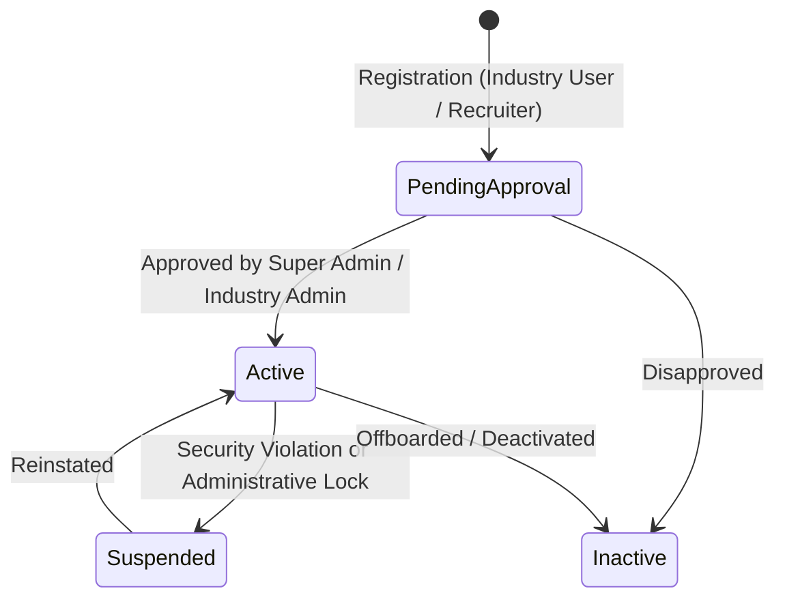

# 25 — User Lifecycle Management & Security Engine

**Project:** Industry Manpower Requirement Portal  
**Organization:** PRAYAS – The Automation Academy  
**Component:** User Administration & Identity Governance  
**Document ID:** DOC-USR-25  
**Status:** Approved & Implemented  

---

## 1. Overview & Objectives

The **User Management Module** (`controllers/UserController.php`, `views/super_admin/users.php`, `user_form.php`, `user_details.php`) provides comprehensive lifecycle administration for all accounts in the portal.

It enforces:
- Strict Role Assignment boundaries
- Identity verification and tenant segregation
- Status controls (`active`, `inactive`, `suspended`, `pending_approval`)
- Administrative password reset and token distribution
- Full user action auditing

---

## 2. User Lifecycle States

### Supported Roles
1. `super_admin`: Full platform control, system settings, RBAC management, audit ledger inspection.
2. `recruiter`: Candidate sourcing, matching, interview scheduling, offer tracking for PRAYAS.
3. `industry_admin`: Company primary administrator; can post requirements, manage industry team members, view matched candidates.
4. `industry_user`: Subordinate enterprise user; can view approved candidates and schedule plant interviews.

---

## 3. Core Features & Capabilities

### A. User Directory (`users.php`)
- **Advanced Filtering:** Filter by Role, Company affiliation, and Account Status.
- **Search Capabilities:** Fast search across Full Name, Email, and Phone.
- **Security Actions:**
  - Status toggle (`active` $\leftrightarrow$ `suspended`).
  - Temporary password generation with forced change on next login.
  - Direct deep-links to User Details & Audit History.

### B. User Creation & Profile Editing (`user_form.php`)
- **Role Scoping:** When selecting `industry_admin` or `industry_user`, selecting an active company is strictly required. When selecting `super_admin` or `recruiter`, company affiliation is disassociated.
- **Password Strength:** Enforces minimum 8 characters, uppercase, lowercase, numbers, and special characters.
- **Duplicate Email Prevention:** Verified against both client and database level constraints.

### C. User Identity Dossier (`user_details.php`)
- **Identity Information:** Name, Email, Phone, Designation, Profile Picture.
- **Access Credentials:** Current Role, Account Status, Last Login Timestamp, Last Login IP, Failed Login Count.
- **Tenant Context:** Associated Company details, company verification status, and plant access.
- **Personal Activity History:** Historical log of the latest 20 actions performed by this user in `audit_logs`.

### D. Administrative Password Reset
- Super Admin can trigger a secure password reset for any user.
- A cryptographically random temporary password is generated using `random_bytes()`.
- The user's `is_password_changed` flag is reset to `0`, requiring mandatory password update upon subsequent login.
- Action is logged in `audit_logs` with the performing Super Admin's ID and IP address.

