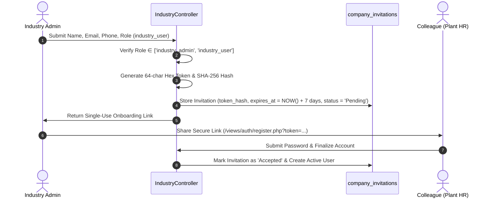

# 32 — Industry Team Member Governance & Invitation Engine

**Project:** Industry Manpower Requirement Portal  
**Organization:** PRAYAS – The Automation Academy  
**Component:** Company User Management & Secure Invitation Engine  
**Document ID:** DOC-IND-32  
**Status:** Approved & Implemented  

---

## 1. Overview & Objectives

The **Industry Team Management Module** (`views/industry/team_members.php`, `invite_member.php`) enables company HR directors and plant leads to onboard colleagues, delegate requisition drafting, and collaborate on candidate evaluations.

---

## 2. Role Boundaries & Privilege Escalation Defenses

To prevent unauthorized administrative escalation, the system strictly enforces the following security boundaries:

1. **Role Scope Restriction:**
   Industry Administrators can **ONLY** invite and assign the following approved company roles:
   - `industry_admin`: Full company administration, plant management, team invitation.
   - `industry_user`: Subordinate collaborator; view requirements and candidate pipelines, review interview schedules.
   
   Attempts to invite or assign `super_admin`, `recruitment_admin`, or `recruiter` are blocked by the controller (`IndustryController::inviteTeamMember`) with an authorization violation alert.

2. **Self-Suspension Protection:**
   An active Industry Admin cannot suspend or deactivate their own user account.

3. **Tenant Affiliation Lock:**
   All team members and invitations are strictly locked to `company_id`. They cannot query or modify data belonging to other employers.

---

## 3. Cryptographic Invitation Architecture

### Invitation Table Attributes (`company_invitations`)
- `token_hash`: SHA-256 hash of the 64-character cryptographically secure token (`bin2hex(random_bytes(32))`).
- `status`: `Pending`, `Accepted`, `Expired`, `Revoked`.
- `expires_at`: Enforces 7-day expiration.
- Single-use guarantee: Tokens are invalidated immediately upon account finalization.

