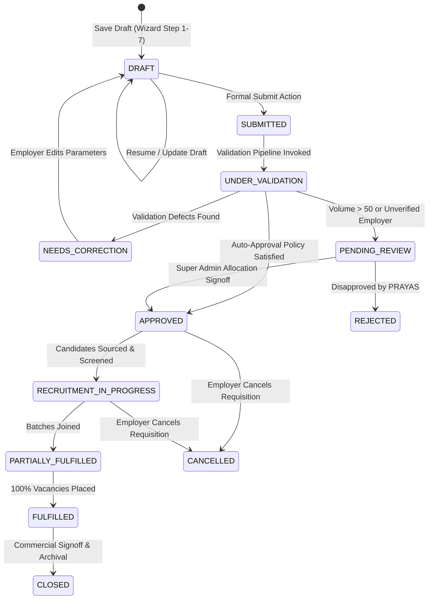

# 39 — Requirement Submission, State Transitions & Audit Workflow

**Project:** Industry Manpower Requirement Portal  
**Organization:** PRAYAS – The Automation Academy  
**Component:** Requisition Lifecycle & Audit Ledger Engine  
**Document ID:** DOC-REQ-39  
**Status:** Approved & Implemented  

---

## 1. Requirement State Machine

Every requirement created within the portal transitions through the following approved states:

---

## 2. Requirement Modification & Cancellation Policies

1. **Modification Rules:**
   - Permitted while in `DRAFT`, `NEEDS_CORRECTION`, or `SUBMITTED`.
   - Modifying an already `APPROVED` requisition resets its status to `UNDER_VALIDATION` or `PENDING_REVIEW` to re-verify operational feasibility.
   - Modifications are permanently blocked once a requirement is `FULFILLED`, `CLOSED`, or `CANCELLED`.

2. **Cancellation Rules:**
   - Industry Admins can cancel active or pending requirements by providing a mandatory cancellation rationale ($\ge 5$ characters).
   - Cancellation transitions the state to `CANCELLED`, halts candidate matching, logs the rationale in `requirement_status_history`, and dispatches an audit event.

---

## 3. Comprehensive Audit Trail & Notification Dispatch

Every transition records an immutable ledger entry in `requirement_status_history` and `audit_logs`:
- **Recorded Event Taxonomy:**
  - `REQUIREMENT_DRAFT_CREATED`
  - `REQUIREMENT_DRAFT_UPDATED`
  - `REQUIREMENT_SUBMITTED`
  - `REQUIREMENT_APPROVED`
  - `REQUIREMENT_CORRECTION_REQUESTED`
  - `REQUIREMENT_CANCELLED`
- **Real-Time Notification Alerts:**
  - When a requirement is auto-approved, an instant in-app notification is dispatched to the employer with the generated `REQ-YYYYMM-XXXX` code.
  - When routed to `PENDING_REVIEW` or `NEEDS_CORRECTION`, explanatory messages guide the user on next steps.

