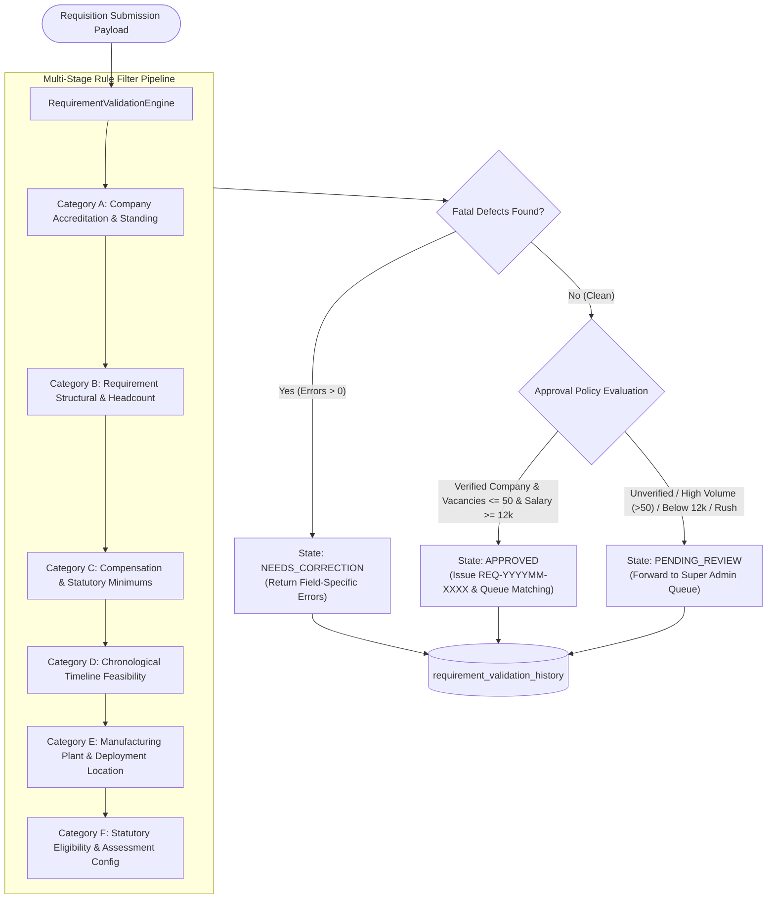

# 40 — Centralized Auto-Validation Engine

## Document Identifier: SPEC-VAL-2026-V1.0
**Project Title:** Industry Manpower Requirement Portal  
**Organization:** PRAYAS – The Automation Academy  
**Backend:** Core PHP + PDO + MySQL  
**Algorithm Reference:** `ALG-VAL-2026-V1.0`  

---

## 1. Architectural Purpose & Overview

The **Centralized Requirement Auto-Validation Engine** ([`includes/requirement_validation_engine.php`](file:///c:/Manpower%20Portal/includes/requirement_validation_engine.php)) serves as the definitive, single-point-of-truth verification system for all industrial manpower requisitions submitted across the PRAYAS portal.

It executes automatically during four vital lifecycle transitions:
1. **Initial Requisition Submission:** Evaluates raw form data upon final wizard completion.
2. **Requisition Modification:** Enforces constraint invariants when draft or correction revisions are submitted.
3. **Resubmission After Correction:** Re-evaluates previously flagged requisitions that entered `NEEDS_CORRECTION`.
4. **Administrative Revalidation:** Permits Super Admin or Academic Evaluators to re-run validation against updated institutional policies.



---

## 2. Multi-Stage Validation Categories & Rule Catalog

Every rule evaluated by the engine is assigned an immutable Rule ID, operational category, target severity, and explainable field-level error message:

### Category A: Company Standing & Accreditation
| Rule ID | Rule Title | Severity | Invariant Condition | Failure Message |
| :--- | :--- | :---: | :--- | :--- |
| `BR-REG-001` | Company Existence | `ERROR` | Company record must exist in `companies` table. | *"Associated company record not found."* |
| `BR-REG-003` | Operational Suspension | `ERROR` | `companies.verification_status` $\ne$ `'Suspended'`. | *"Company account is currently suspended. Submissions are blocked."* |
| `BR-VER-001` | Commercial Accreditation | `MANUAL_REVIEW` | `verification_status` $\in$ `['Verified', 'Active']`. | *"Employer verification status is 'Pending'. Sourcing requires administrative approval."* |

### Category B: Requirement Structural & Headcount Integrity
| Rule ID | Rule Title | Severity | Invariant Condition | Failure Message |
| :--- | :--- | :---: | :--- | :--- |
| `ERR-TIT-01` | Title Character Length | `ERROR` | $5 \le \text{strlen}(\text{title}) \le 255$. | *"Requirement title must be between 5 and 255 characters."* |
| `ERR-DSC-01` | Job Description Completeness | `ERROR` | $\text{strlen}(\text{job\_description}) \ge 20$. | *"Job description must provide at least 20 characters of contextual specifications."* |
| `ERR-QTY-01` | Vacancy Quantity Bounds | `ERROR` | $1 \le \text{quantity\_required} \le 500$. | *"Total vacancy quantity must be a positive integer between 1 and 500."* |
| `ERR-TRD-01` | Mandatory Trade Selection | `ERROR` | $\text{count}(\text{trades}) \ge 1$. | *"At least one ITI technical trade must be allocated."* |
| `ERR-TRD-03` | Trade Vacancy Parity | `ERROR` | $\sum \text{trade\_vacancies} = \text{quantity\_required}$. | *"Total vacancies ({qty}) does not match the sum of trade allocations ({sum})."* |
| `ERR-YEA-03` | Passing Batch Order | `ERROR` | $\text{passing\_year\_from} \le \text{passing\_year\_to}$. | *"Passing year to cannot precede passing year from."* |

### Category C: Compensation & Remuneration
| Rule ID | Rule Title | Severity | Invariant Condition | Failure Message |
| :--- | :--- | :---: | :--- | :--- |
| `ERR-SAL-01` | Minimum Salary Positive | `ERROR` | $\text{min\_salary} > 0$. | *"Minimum salary must be greater than zero."* |
| `ERR-SAL-02` | Salary Range Inversion | `ERROR` | $\text{max\_salary} \ge \text{min\_salary}$. | *"Maximum salary must be greater than or equal to minimum salary."* |
| `WARN-SAL-01` | Regional Technician Benchmark | `WARNING` | $\text{min\_salary} \ge \text{₹12,000}$. | *(Warning)* *"Minimum salary is below the regional ₹12,000 industrial technician benchmark."* |
| `ERR-SAL-03` | Salary Frequency Type | `ERROR` | $\text{type} \in \text{['Monthly', 'Stipend', 'Annual']}$. | *"Invalid compensation frequency type specified."* |

### Category D: Chronological Timeline Coherence
Let $T_{\text{today}}$ be today's date timestamp, $T_{\text{dead}}$ application deadline, $T_{\text{int}}$ interview date, and $T_{\text{join}}$ target joining date:
$$\text{Chronological Invariant: } T_{\text{today}} \le T_{\text{dead}} \le T_{\text{int}} \le T_{\text{join}}$$

| Rule ID | Rule Title | Severity | Invariant Condition | Failure Message |
| :--- | :--- | :---: | :--- | :--- |
| `ERR-DAT-01` | Past Application Deadline | `ERROR` | $T_{\text{dead}} \ge T_{\text{today}}$. | *"Application deadline cannot be in the past."* |
| `ERR-DAT-02` | Premature Interview Date | `ERROR` | $T_{\text{int}} \ge T_{\text{dead}}$. | *"Interview date must occur on or after the application deadline."* |
| `ERR-DAT-03` | Premature Joining Milestone | `ERROR` | $T_{\text{join}} \ge T_{\text{int}}$. | *"Target joining date must occur after the interview/application milestones."* |
| `WARN-DAT-01`| Rapid Turnaround Warning | `WARNING` | $T_{\text{join}} - T_{\text{today}} \ge 7\text{ days}$. | *(Warning)* *"Target joining date is within 7 days; expedited recruitment sourcing will be prioritized."* |

### Category E & F: Location & Statutory Candidate Eligibility
| Rule ID | Rule Title | Severity | Invariant Condition | Failure Message |
| :--- | :--- | :---: | :--- | :--- |
| `ERR-LOC-01` | Plant Ownership Verification | `ERROR` | `manufacturing_plants.company_id` matches session. | *"Specified manufacturing plant was not found or does not belong to your company."* |
| `ERR-LOC-02` | Plant Active Status | `ERROR` | `manufacturing_plants.status` = `'Active'`. | *"Selected manufacturing plant is inactive."* |
| `ERR-AGE-01` | Factories Act Minimum Age | `ERROR` | $\text{min\_age} \ge 18$. | *"Minimum candidate age cannot be less than 18 years under the Factories Act."* |
| `ERR-AGE-02` | Age Range Order | `ERROR` | $\text{max\_age} \ge \text{min\_age}$. | *"Maximum age cannot be less than minimum age."* |

---

## 3. Explainable Result Data Structure

The engine guarantees zero vague error messages. Outcomes are returned as a structured associative array:

```php
[
    'is_valid'          => bool,       // True if zero fatal errors
    'validation_run_id' => string,     // Unique run identifier (e.g. VAL-20261105-123456-a1b2)
    'target_status'     => string,     // 'APPROVED', 'PENDING_REVIEW', or 'NEEDS_CORRECTION'
    'errors'            => array,      // Keyed by field name for live UI error-state binding
    'warnings'          => array,      // Non-fatal advisory notices
    'manual_reviews'    => array,      // Explicit reasons triggering human administrative vetting
    'rule_results'      => array,      // Full itemized audit trail of every evaluated rule
    'summary'           => [
        'total_rules'   => int,
        'passed'        => int,
        'failed'        => int,
        'warnings'      => int,
        'manual_reviews'=> int
    ],
    'version'           => 'ALG-VAL-2026-V1.0',
    'timestamp'         => '2026-11-05 12:35:00'
]
```

