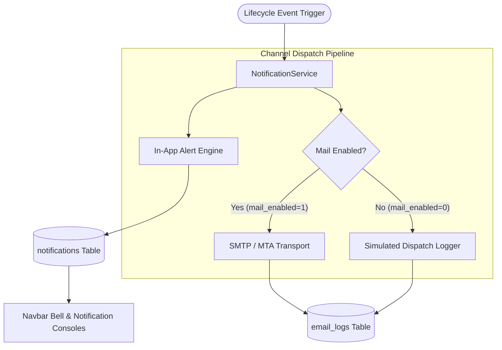

# 42 — Centralized Notification Engine

## Document Identifier: SPEC-NOTIF-2026-V1.0
**Project Title:** Industry Manpower Requirement Portal  
**Organization:** PRAYAS – The Automation Academy  
**Service Class:** [`NotificationService`](file:///c:/Manpower%20Portal/includes/notification_service.php)  
**Database Tables:** `notifications`, `email_logs`, `deadline_reminder_logs`  

---

## 1. System Architecture

The **Notification Engine** coordinates all communication channels across the PRAYAS portal, providing immediate, role-scoped in-app alerts and responsive HTML email dispatches for critical milestones in the recruitment and accreditation lifecycles.



---

## 2. Supported Lifecycle Notification Events

The engine implements event taxonomies partitioned by stakeholder responsibility:

### Industrial Employers (`industry_admin`, `industry_user`):
- `COMPANY_REGISTRATION_RECEIVED`: Notifies user that company registration is undergoing review.
- `COMPANY_APPROVED`: Real-time accreditation alert enabling live requirement postings.
- `COMPANY_REJECTED`: Notice of documentation non-compliance with evaluator rationale.
- `REQUIREMENT_SUBMITTED`: Confirmation of requisition receipt.
- `REQUIREMENT_APPROVED`: Requisition passed validation and entered ITI sourcing.
- `REQUIREMENT_NEEDS_CORRECTION`: Notice of data defects requiring correction.
- `REQUIREMENT_UNDER_MANUAL_REVIEW`: Notice that high-volume or rush requisition is undergoing committee review.
- `DEADLINE_APPROACHING`: Application deadline window is within 3 days.

### Super Administration (`super_admin`):
- `NEW_COMPANY_REGISTRATION`: Alert when a new industrial partner registers.
- `NEW_APPROVED_REQUIREMENT`: Broadcast when a requirement enters the sourcing pipeline.
- `REQUIREMENT_NEEDS_MANUAL_REVIEW`: Priority queue alert when a requisition needs human signoff.
- `COMPANY_REVERIFICATION_REQUIRED`: Alert when an accredited company modifies legal/statutory credentials.

### Recruiter & Academic Desk (`recruitment_admin`, `recruiter`):
- `NEW_APPROVED_REQUIREMENT`: Notifies recruiters of actionable requirements ready for batch querying.
- `RECRUITMENT_ASSIGNMENT`: Alerts a recruiter when assigned to lead a company's hiring drive.
- `RECRUITMENT_DEADLINE_APPROACHING`: Alerts interview coordinators of upcoming assessment dates.

---

## 3. Data Structure & Ownership Guarantees

Every in-app notification enforces strict ownership verification:
```sql
SELECT id, company_id, notification_type, title, message, action_url, 
       entity_type, entity_id, is_read, read_at, status, created_at 
FROM `notifications` 
WHERE recipient_user_id = :uid
```

### Anti-IDOR Security:
Mark-as-read, delete, and view operations mandate `$userId = getUserId()` derived from authenticated session state. Attempting to mark or delete a notification belonging to another user is rejected with zero mutations.

