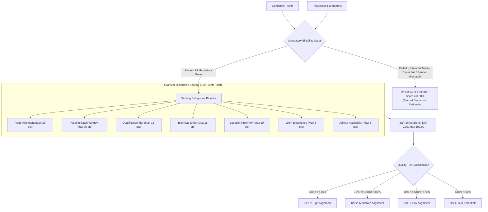

# 46 — Algorithmic Candidate Matching Engine

## Document Identifier: SPEC-MAT-ALG-2026-V1.0
**Project Title:** Industry Manpower Requirement Portal  
**Organization:** PRAYAS – The Automation Academy  
**Model Class:** [`CandidateMatchingModel`](file:///c:/Manpower%20Portal/models/CandidateMatchingModel.php)  
**Algorithm Reference:** `ALG-MAT-2026-V1.0`  

---

## 1. Mathematical Formulation & Scoring Model

The matching algorithm computes a calibrated similarity metric $S \in [0.00, 100.00]$ between a candidate profile $C$ and an industrial requisition $R$:

$$S(C, R) = \begin{cases} 
0.00 & \text{if } \text{Eligible}(C, R) = \text{False} \\
S_{\text{trade}} + S_{\text{batch}} + S_{\text{qual}} + S_{\text{skills}} + S_{\text{loc}} + S_{\text{exp}} + S_{\text{avail}} & \text{if } \text{Eligible}(C, R) = \text{True}
\end{cases}$$

---

## 2. Dimension Scoring Rules & Weights

### Dimension A: Technical Trade Alignment ($W_A = 30.0$ Points)
- **Exact Trade Match:** Candidate trade matches any requisition trade exactly $\rightarrow \mathbf{30.0 \text{ pts}}$.
- **Related Trade Cross-Walk:** Candidate trade belongs to recognized cross-walk cluster (e.g. Wireman for Electrician, Turner for Machinist) $\rightarrow \mathbf{20.0 \text{ pts}}$.
- **Unrelated Trade:** Candidate fails mandatory gate $\rightarrow \mathbf{0.0 \text{ pts}}$.

### Dimension B: Passing Batch Window ($W_B = 20.0$ Points)
Let $[Y_{\text{from}}, Y_{\text{to}}]$ be the requisition's preferred passing window and $Y_C$ be candidate graduation year:
- **Exact Window:** $Y_{\text{from}} \le Y_C \le Y_{\text{to}} \rightarrow \mathbf{20.0 \text{ pts}}$.
- **Adjacent Batch ($\pm 1$ Year):** $|Y_C - Y_{\text{window}}| = 1 \rightarrow \mathbf{12.0 \text{ pts}}$.
- **Adjacent Batch ($\pm 2$ Years):** $|Y_C - Y_{\text{window}}| = 2 \rightarrow \mathbf{6.0 \text{ pts}}$.
- **Unrestricted / Default:** Requisition specifies no batch limits $\rightarrow \mathbf{20.0 \text{ pts}}$.

### Dimension C: Qualification Tier ($W_C = 15.0$ Points)
- **Exact Qualification ('ITI Passed'):** $\mathbf{15.0 \text{ pts}}$.
- **Equivalent / Higher Technical ('Diploma', 'Apprentice'):** $\mathbf{12.0 \text{ pts}}$.
- **Other Technical Certification:** $\mathbf{7.5 \text{ pts}}$.

### Dimension D: Technical Skills Alignment ($W_D = 15.0$ Points)
$$\text{SkillRatio} = \frac{\text{Count of Requisition Skills present in Candidate Profile}}{\text{Total Requisition Skills}}$$
$$S_{\text{skills}} = 15.0 \times \max(0.40, \text{SkillRatio})$$

### Dimension E: Location Proximity ($W_E = 10.0$ Points)
- **Same Industrial City / Zone:** $\mathbf{10.0 \text{ pts}}$.
- **Same District:** $\mathbf{8.0 \text{ pts}}$.
- **Same State (Maharashtra):** $\mathbf{5.0 \text{ pts}}$.
- **Other State / Inter-State Relocation:** $\mathbf{3.0 \text{ pts}}$.

### Dimension F & G: Experience & Availability ($W_F = 5.0, W_G = 5.0$ Points)
- **Experience Match:** Meets required experience tier (Fresher vs 1-2 Years) $\rightarrow \mathbf{5.0 \text{ pts}}$.
- **Availability Match:** Standard active batch availability $\rightarrow \mathbf{5.0 \text{ pts}}$.

---

## 3. Mandatory Eligibility Gates

Before any point calculation is credited, the candidate profile must satisfy three mandatory threshold gates:
1. **Trade Eligibility:** Candidate trade must be an exact or recognized adjacent cross-walk match.
2. **Academic Examination Result:** Candidates marked with examination status `FAIL` are immediately flagged as `NOT_ELIGIBLE` with reason: *"Candidate ITI examination status is marked FAIL."*
3. **Statutory Gender Criterion:** If the industrial requisition strictly specifies a non-'Any' gender preference (e.g. female-only shifts with statutory compliance), mismatching profiles are gated out.

