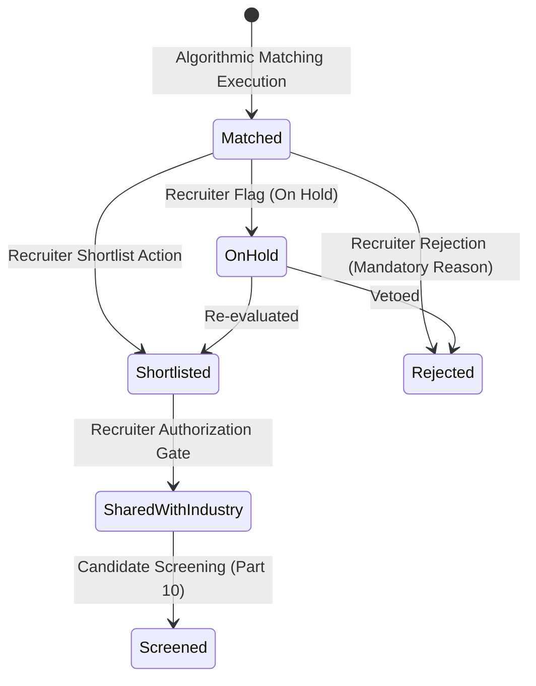

# 47 — Candidate Shortlisting & Recruiter Workflow

## Document Identifier: SPEC-SHL-FLOW-2026-V1.0
**Project Title:** Industry Manpower Requirement Portal  
**Organization:** PRAYAS – The Automation Academy  
**Console:** [`views/recruiter/candidate_matching.php`](file:///c:/Manpower%20Portal/views/recruiter/candidate_matching.php)  
**Database Tables:** `candidate_matches`, `candidate_shortlist_actions`  

---

## 1. Recruitment Workflow & Gate Sequencing

The PRAYAS recruitment workflow enforces a deliberate human-in-the-loop governance model. The matching engine identifies and ranks potential candidate pools, but candidates are never automatically pushed to an employer without recruiter review and explicit sharing authorization.

---

## 2. Recruiter Action Capabilities

### A. Candidate Shortlisting
- **Action Code:** `SHORTLIST`
- **Effect:** Sets `candidate_matches.status = 'Shortlisted'`. Moves profile into active screening pipeline.
- **Audit:** Records recruiter user ID, timestamp, and optional technical notes in `candidate_shortlist_actions`.

### B. Mandatory Rejection with Rationale
- **Action Code:** `REJECT`
- **Effect:** Sets `candidate_matches.status = 'Rejected'` and records `rejection_reason`.
- **Constraint:** Rationale is mandatory (rejection blocked without non-empty text).

### C. Industry Sharing Authorization Gate
- **Action Code:** `SHARE_WITH_INDUSTRY`
- **Effect:** Sets `candidate_matches.is_shared_with_industry = 1` and `shared_at = NOW()`.
- **Privacy Enforcement:** Prior to this action, the candidate record is strictly hidden from the Industry Partner portal (`is_shared_with_industry = 0`). Only authorized recruiters can release profiles.

---

## 3. Recruiter Dashboard Interface

The Recruiter Console provides:
1. **Target Requisition Selector:** Filter by approved, in-progress, or partially fulfilled requisitions.
2. **One-Click Algorithm Execution:** Triggers atomic `executeMatchingRun()` recalculation.
3. **Interactive Score Diagnostics:** Modal inspecting exact points across all 7 dimensions and diagnostic notes.
4. **Fast Multi-Tier Filtering:** Slice candidates by Score Tiers ($\ge 85\%$, $70-84\%$, $50-69\%$, $<70\%$) or pipeline statuses.

