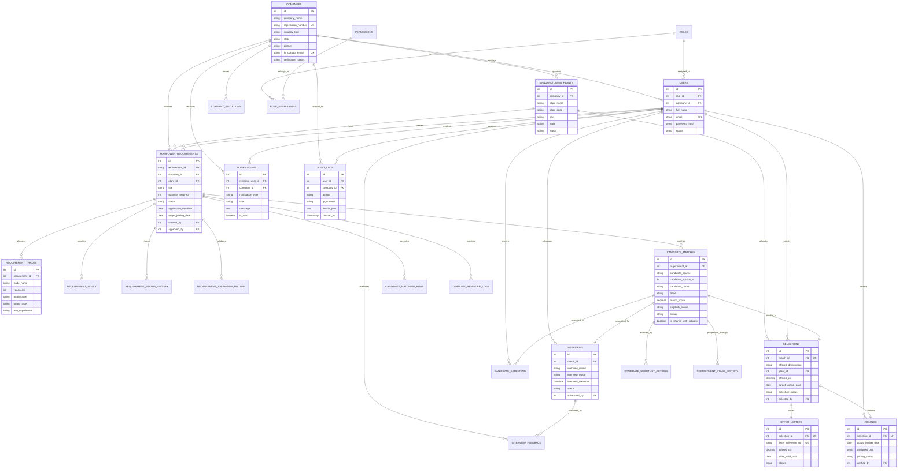

# Part 03 — Database Entity Relationship (ER) Diagram
## PRAYAS – The Automation Academy | Industry Manpower Requirement Portal

**Project:** Industry Manpower Requirement Portal  
**Organization:** PRAYAS – The Automation Academy  
**Database Schema:** `manpower_portal_db`  
**Diagram Type:** Actual Physical Schema (Mermaid ER)  
**Document Code:** `DOC-REBUILD-03-ER-DIAGRAM`

---

## 1. Executive Summary

This document presents the complete Entity-Relationship (ER) model representing the **actual physical schema** of `manpower_portal_db`. All tables, keys, cardinalities, and relationship types (1:1, 1:N, N:M) reflect the live inspected database without invention or distortion.

---

## 2. Mermaid Entity-Relationship Diagram

---

## 3. Relationship Multiplicity & Cardinality Summary

| Parent Entity | Child Entity | Relationship Type | Enforced FK Constraint | Action on Delete |
|---|---|:---:|---|:---:|
| `companies` | `users` | 1 to Many (1:N) | `users.company_id` | RESTRICT |
| `companies` | `manufacturing_plants` | 1 to Many (1:N) | `manufacturing_plants.company_id` | CASCADE |
| `companies` | `manpower_requirements` | 1 to Many (1:N) | `manpower_requirements.company_id` | RESTRICT |
| `roles` | `role_permissions` | 1 to Many (1:N) | `role_permissions.role_id` | CASCADE |
| `permissions` | `role_permissions` | 1 to Many (1:N) | `role_permissions.permission_id` | CASCADE |
| `manpower_requirements` | `requirement_trades` | 1 to Many (1:N) | `requirement_trades.requirement_id` | CASCADE |
| `manpower_requirements` | `candidate_matches` | 1 to Many (1:N) | `candidate_matches.requirement_id` | RESTRICT |
| `candidate_matches` | `interviews` | 1 to Many (1:N) | `interviews.match_id` | CASCADE |
| `candidate_matches` | `selections` | 1 to 1 (1:1 Unique) | `selections.match_id` | RESTRICT |
| `selections` | `offer_letters` | 1 to 1 (1:1 Unique) | `offer_letters.selection_id` | RESTRICT |
| `selections` | `joinings` | 1 to 1 (1:1 Unique) | `joinings.selection_id` | RESTRICT |
| `interviews` | `interview_feedback` | 1 to Many (1:N) | `interview_feedback.interview_id` | CASCADE |
| `users` | `audit_logs` | 1 to Many (1:N) | `audit_logs.user_id` | SET NULL |

---

## 4. Integrity Analysis & Referential Security

1. **Cascade Boundaries:** Critical operational master records (`companies`, `users`, `manpower_requirements`) enforce `RESTRICT` on delete, completely eliminating accidental cascading destruction of active hiring data.
2. **Sub-item Cascade Cleanup:** Sub-allocations (`requirement_trades`, `requirement_skills`, `candidate_screening`, `interview_feedback`) enforce `CASCADE` on delete, ensuring clean garbage collection if draft requisitions or test matching fixtures are explicitly removed.
3. **1-to-1 Pipeline Enforcement:** The candidate pipeline strictly enforces 1:1 progression from `candidate_matches` to `selections`, `offer_letters`, and `joinings` via unique keys on `match_id` and `selection_id`. A candidate cannot be selected or offered twice for the same match.

