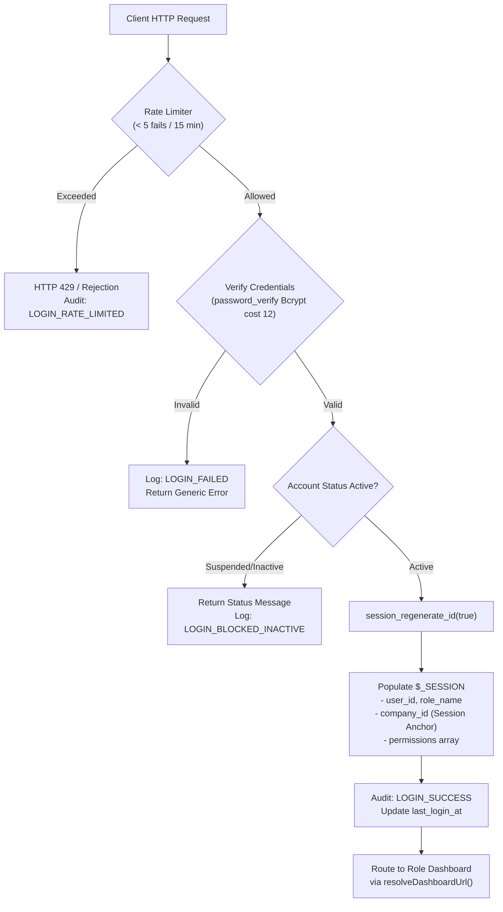

# Part 04 — Authentication Architecture & Session Security
**PRAYAS — The Automation Academy**  
*Industry Manpower Requirement Portal*  
**Document Version:** 2.0  
**Phase:** Cycle 2.0 Modernization & Stabilization  

---

## 1. Architectural Overview

The PRAYAS Industry Manpower Requirement Portal enforces a centralized, defense-in-depth authentication and session management architecture built with Core PHP, PDO, and MySQL.

The architecture guarantees:
- **Zero Client Trust:** Authentication state and tenant association are strictly derived from server-side session data (`$_SESSION['user_id']`, `$_SESSION['company_id']`, `$_SESSION['role_name']`). Client-supplied `GET` or `POST` parameters can never override tenant scope.
- **Session Fixation Immunity:** Session IDs are cryptographically regenerated via `session_regenerate_id(true)` upon successful credential verification.
- **Brute-Force & Abuse Mitigation:** Sliding 15-minute rate-limiting window restricting failed login attempts to a maximum of 5 before triggering a temporary 15-minute account lockout.
- **Modern Cryptographic Standards:** Passwords are hashed using `PASSWORD_BCRYPT` with an adaptive algorithmic cost factor of 12.
- **Multi-Tenant Isolation:** Complete logical separation between different industrial employers via session-anchored company IDs and server-side route guards.



---

## 2. Core Authentication Components

### 2.1 Centralized Files & Responsibilities
| Component Path | Primary Responsibility |
| :--- | :--- |
| `controllers/AuthController.php` | Handles authentication lifecycle: login, logout, registration, password change, reset token generation, rate limiting. |
| `includes/session.php` | Configures secure cookie parameters, strict session mode, idle timeout enforcement (1800s), and URL base helper `app_url()`. |
| `includes/auth_guard.php` | Enforces server-side route barriers: `requireAuth()`, `requireRole()`, `requirePermission()`, `requireCompanyAccess()`, `requireCompanyVerified()`. |
| `includes/permissions.php` | Provides identity query helpers: `isAuthenticated()`, `getAuthUser()`, `getCompanyId()`, `getRoleName()`, `hasRole()`, `hasPermission()`. |
| `includes/csrf.php` | Manages anti-CSRF token lifecycle, field rendering, and strict POST/PUT/DELETE validation. |

---

## 3. Session Security & Hardening Configuration

### 3.1 Cookie & Runtime Parameters
Before any session is initialized in `includes/session.php`, secure runtime parameters are established:
- **Lifetime:** `0` (session cookie expires immediately upon browser closure).
- **HttpOnly:** `true` (prohibits JavaScript document.cookie access, mitigating XSS session theft).
- **SameSite:** `Lax` (defends against cross-site request forgery while permitting top-level navigation).
- **Secure:** `true` dynamically when HTTPS or port 443 is active.
- **Strict Mode:** `session.use_strict_mode = 1` (rejects uninitialized, attacker-supplied session identifiers).
- **Cookie-Only Storage:** `session.use_only_cookies = 1` (prevents transparent session passing via URL parameters).

### 3.2 Idle Session Inactivity Timeout
- **Threshold:** `1800` seconds (30 minutes) of inactivity.
- **Mechanism:** On every authenticated request, `$_SESSION['last_activity']` is evaluated against current time. If `time() - $_SESSION['last_activity'] > 1800`, `destroySecureSession()` is executed and the user is redirected to the login endpoint with an expiration notification.

---

## 4. Password Security & Cryptographic Lifecycle

### 4.1 Hashing Specifications
- **Algorithm:** `PASSWORD_BCRYPT` (PHP standard blowfish implementation).
- **Cost Factor:** `12` (provides optimal defense against GPU-accelerated offline cracking).
- **Zero Plaintext Storage:** Passwords exist in memory only during verification or registration execution. Database contains only 60-character bcrypt hash strings.

### 4.2 Complexity Policy
- Minimum length: 8 characters.
- Character diversity: At least one alphabetic character (`[A-Za-z]`) and at least one numeric digit (`[0-9]`).
- Password change validation: Requires verification of current password, mismatch between old and new passwords, and confirmation parity.

### 4.3 Password Reset Subsystem
- **Token Generation:** 32 cryptographically random bytes via `random_bytes(32)`.
- **Token Storage:** Tokens are hashed with `hash('sha256', $rawToken)` before storage in `password_resets`. Raw tokens are never stored in the database.
- **Expiration:** Tokens are valid for exactly 1 hour (`INTERVAL 1 HOUR`).
- **Single-Use Enforcement:** Tokens are stamped with `used_at = NOW()` upon successful password reset; reuse attempts are strictly blocked.
- **Enumeration Defense:** Password reset requests return identical generic messages regardless of whether the email exists in the database.

---

## 5. Multi-Tenant Data Isolation (IDOR Guard)

In multi-tenant architectures, Insecure Direct Object References (IDOR) occur when an application relies on client-provided IDs (e.g. `?company_id=12`).

The PRAYAS portal neutralizes this threat through a two-tiered enforcement model:

1. **Session Anchor (`getCompanyId()`):**
   ```php
   function getCompanyId(): ?int
   {
       return isset($_SESSION['company_id']) ? (int)$_SESSION['company_id'] : null;
   }
   ```
   Client-supplied `$_GET['company_id']` or `$_POST['company_id']` values are completely ignored by controllers and models.

2. **Server-Side Route Barrier (`requireCompanyAccess()`):**
   ```php
   function requireCompanyAccess(int|string|null $targetCompanyId): void
   {
       requireAuth();
       if (hasRole('super_admin') || hasRole(['recruitment_admin', 'recruiter'])) {
           return; // Platform administration or recruitment authority
       }
       $authCompanyId = getCompanyId();
       if ($authCompanyId === null || (int)$targetCompanyId !== $authCompanyId) {
           renderForbiddenResponse("Tenant Data Isolation Violation: Unauthorized attempt to access cross-company resources.");
       }
   }
   ```
   Any cross-tenant access attempt immediately halts execution with an HTTP 403 Forbidden response and logs a `TENANT_ISOLATION_VIOLATION` security audit record.

