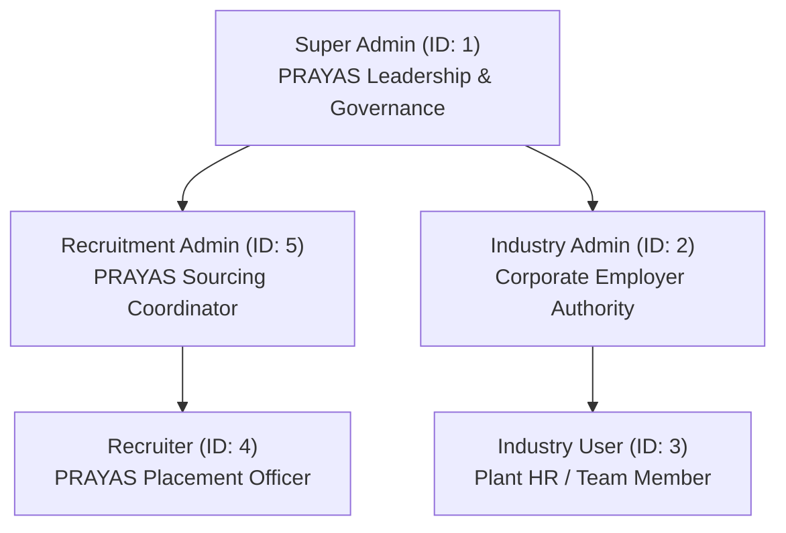

# Part 04 — Role-Based Access Control (RBAC) & Permission Matrix
**PRAYAS — The Automation Academy**  
*Industry Manpower Requirement Portal*  
**Document Version:** 2.0  
**Phase:** Cycle 2.0 Modernization & Stabilization  

---

## 1. Role Taxonomy & Authority Hierarchy

The PRAYAS Industry Manpower Requirement Portal defines a five-tier role hierarchy stored in the `roles` table. All roles adhere to the principle of least privilege (PoLP).

### 1.1 Role Definitions
| Role Identifier | Role Name in DB | Scope & Jurisdiction | Multi-Tenant Model |
| :--- | :--- | :--- | :--- |
| **Super Admin** | `super_admin` | Global platform administration, company approvals, master settings, audit ledger, and cross-company governance. | Unrestricted / Universal access override |
| **Recruitment Admin**| `recruitment_admin` | Recruitment oversight, candidate sourcing, pipeline orchestration, multi-company demand matching, placement reports. | Cross-company recruitment scope |
| **Recruiter** | `recruiter` | Candidate matching execution, screening, interview scheduling, offer tracking, and feedback collection for assigned requisitions. | Assigned requirements & candidates |
| **Industry Admin** | `industry_admin` | Full authority over affiliated company: company profile, manufacturing plants, team members, requisitions, candidate interviews, offers. | Strictly isolated to affiliated `company_id` |
| **Industry User** | `industry_user` | Team member within an industrial company: requisition draft viewing, interview status review, feedback participation. | Strictly isolated to affiliated `company_id` (read/operational) |

---

## 2. Granular RBAC Permission Matrix

The database defines permissions in the `permissions` table, mapped to roles via `role_permissions`.

| Module Capability | Permission Key | Super Admin | Recruitment Admin | Recruiter | Industry Admin | Industry User |
| :--- | :--- | :---: | :---: | :---: | :---: | :---: |
| **System Governance** | | | | | | |
| Manage System Settings | `settings.manage` | **ALLOW** | DENY | DENY | DENY | DENY |
| Manage Roles & Permissions| `roles.manage` | **ALLOW** | DENY | DENY | DENY | DENY |
| View Security Audit Logs | `audit.view` | **ALLOW** | DENY | DENY | DENY | DENY |
| Export Audit Trail CSV | `audit.export` | **ALLOW** | DENY | DENY | DENY | DENY |
| **User Administration** | | | | | | |
| View All System Users | `user.view_all` | **ALLOW** | ALLOW | DENY | DENY | DENY |
| Create Recruiter/Staff | `user.create_staff` | **ALLOW** | DENY | DENY | DENY | DENY |
| Suspend/Activate Users | `user.suspend` | **ALLOW** | DENY | DENY | DENY | DENY |
| Manage Company Team | `team.manage` | **ALLOW** | DENY | DENY | **ALLOW** | DENY |
| **Company Governance** | | | | | | |
| View All Companies | `company.view_all` | **ALLOW** | ALLOW | ALLOW | DENY | DENY |
| Verify/Reject Company | `company.verify` | **ALLOW** | DENY | DENY | DENY | DENY |
| Suspend Company | `company.suspend` | **ALLOW** | DENY | DENY | DENY | DENY |
| Edit Own Company Profile | `company.edit_own` | **ALLOW** | DENY | DENY | **ALLOW** | DENY |
| Manage Manufacturing Plants | `plant.manage` | **ALLOW** | DENY | DENY | **ALLOW** | DENY |
| **Manpower Requirements** | | | | | | |
| Submit New Requisition | `requirement.create` | **ALLOW** | DENY | DENY | **ALLOW** | **ALLOW** |
| Edit Own Requisition | `requirement.edit` | **ALLOW** | DENY | DENY | **ALLOW** | DENY |
| Review / Approve Demand | `requirement.approve` | **ALLOW** | **ALLOW** | DENY | DENY | DENY |
| Cancel Own Requisition | `requirement.cancel` | **ALLOW** | DENY | DENY | **ALLOW** | DENY |
| View All Requisitions | `requirement.view_all`| **ALLOW** | **ALLOW** | **ALLOW** | DENY | DENY |
| View Own Requisitions | `requirement.view_own`| **ALLOW** | ALLOW | ALLOW | **ALLOW** | **ALLOW** |
| **Candidate Matching** | | | | | | |
| Access Full ITI Pool | `candidate.pool_access`| **ALLOW** | **ALLOW** | **ALLOW** | DENY | DENY |
| Trigger Algorithmic Match | `match.execute` | **ALLOW** | **ALLOW** | **ALLOW** | DENY | DENY |
| Share Matches to Employer | `candidate.share` | **ALLOW** | **ALLOW** | **ALLOW** | DENY | DENY |
| View Shared Candidates | `candidate.view_shared`| **ALLOW** | **ALLOW** | **ALLOW** | **ALLOW** | **ALLOW** |
| View Redacted PII | `candidate.view_pii` | **ALLOW** | **ALLOW** | **ALLOW** | DENY (Pre-hire)| DENY |
| **Recruitment Pipeline** | | | | | | |
| Move Pipeline Stage | `pipeline.transition` | **ALLOW** | **ALLOW** | **ALLOW** | DENY | DENY |
| Schedule Interview | `interview.schedule` | **ALLOW** | **ALLOW** | **ALLOW** | **ALLOW** | **ALLOW** |
| Record Interview Feedback | `interview.feedback` | **ALLOW** | **ALLOW** | **ALLOW** | **ALLOW** | **ALLOW** |
| Issue Employment Offer | `offer.issue` | **ALLOW** | **ALLOW** | **ALLOW** | **ALLOW** | DENY |
| Confirm Candidate Joining | `joining.confirm` | **ALLOW** | **ALLOW** | **ALLOW** | **ALLOW** | DENY |
| **Reports & Analytics** | | | | | | |
| View Executive Dashboard | `reports.executive` | **ALLOW** | **ALLOW** | DENY | DENY | DENY |
| View Company Analytics | `reports.company` | **ALLOW** | **ALLOW** | DENY | **ALLOW** | **ALLOW** |
| View Recruiter Funnel | `reports.pipeline` | **ALLOW** | **ALLOW** | **ALLOW** | DENY | DENY |
| Export Analytical Reports | `reports.export` | **ALLOW** | **ALLOW** | **ALLOW** | **ALLOW** | DENY |

---

## 3. Server-Side URL Route Protection Mapping

Route protection is strictly enforced server-side. Missing or unauthorized roles produce an immediate `HTTP 403 Forbidden` response and write an audit event.

### 3.1 Super Admin Domain (`views/super_admin/`)
| Protected View Script | Enforced Route Guard | Failure Outcome |
| :--- | :--- | :--- |
| `dashboard.php` | `requireRole('super_admin')` | 403 Forbidden |
| `companies.php` | `requireRole('super_admin')` | 403 Forbidden |
| `company_details.php` | `requireRole('super_admin')` | 403 Forbidden |
| `company_form.php` | `requireRole('super_admin')` | 403 Forbidden |
| `users.php` | `requireRole('super_admin')` | 403 Forbidden |
| `user_details.php` | `requireRole('super_admin')` | 403 Forbidden |
| `user_form.php` | `requireRole('super_admin')` | 403 Forbidden |
| `roles_permissions.php` | `requireRole('super_admin')` | 403 Forbidden |
| `system_settings.php` | `requireRole('super_admin')` | 403 Forbidden |
| `audit_logs.php` | `requireRole('super_admin')` | 403 Forbidden |
| `reports.php` | `requireRole(['super_admin', 'recruiter', 'recruitment_admin'])` | 403 Forbidden |

### 3.2 Industry Partner Domain (`views/industry/`)
| Protected View Script | Enforced Route Guard | Failure Outcome |
| :--- | :--- | :--- |
| `dashboard.php` | `requireRole(['industry_admin', 'industry_user'])` | 403 Forbidden |
| `company_profile.php` | `requireRole(['industry_admin', 'industry_user'])` | 403 Forbidden |
| `plants.php` | `requireRole(['industry_admin', 'industry_user'])` | 403 Forbidden |
| `plant_form.php` | `requireRole(['industry_admin', 'industry_user'])` | 403 Forbidden |
| `team_members.php` | `requireRole('industry_admin')` | 403 Forbidden |
| `invite_member.php` | `requireRole('industry_admin')` | 403 Forbidden |
| `requirements.php` | `requireRole(['industry_admin', 'industry_user'])` | 403 Forbidden |
| `requirement_form.php`| `requireRole(['industry_admin', 'industry_user'])` | 403 Forbidden |
| `requirement_details.php`| `requireRole(['industry_admin', 'industry_user'])` | 403 Forbidden |
| `candidate_matches.php`| `requireRole(['industry_admin', 'industry_user'])` | 403 Forbidden |
| `reports.php` | `requireRole(['industry_admin', 'industry_user'])` | 403 Forbidden |

### 3.3 Recruiter Domain (`views/recruiter/`)
| Protected View Script | Enforced Route Guard | Failure Outcome |
| :--- | :--- | :--- |
| `candidate_matching.php` | `requireRole(['recruiter', 'recruitment_admin', 'super_admin'])` | 403 Forbidden |
| `recruitment_pipeline.php`| `requireRole(['recruiter', 'recruitment_admin', 'super_admin'])` | 403 Forbidden |
| `recruitment_reports.php` | `requireRole(['recruiter', 'recruitment_admin', 'super_admin'])` | 403 Forbidden |

---

## 4. Privilege Escalation Defense Rules

1. **Self-Suspension Guard:** Super Admins cannot suspend or delete their own active user account.
2. **Super Admin Lockout Prevention:** The system prevents revoking `super_admin` permissions from the last active Super Admin account.
3. **Company Linkage Validation:** Industry Admin and User accounts cannot be registered or created without a verified foreign key reference in `companies`.
4. **Tenant Scoping Enforcement:** All database queries executed on behalf of an industrial user are scoped by `company_id = getCompanyId()`, rendering parameter tampering attempts harmless.

