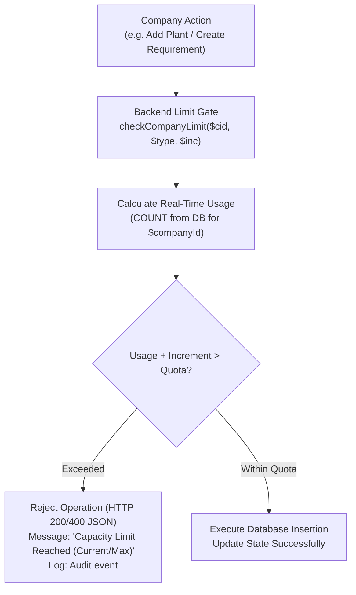

# Part 05 — Company Limit Management & Capacity Quotas
**PRAYAS — The Automation Academy**  
*Industry Manpower Requirement Portal*  
**Document Version:** 2.0  
**Phase:** Cycle 2.0 Modernization & Stabilization  

---

## 1. Executive Overview

A critical requirement of the PRAYAS Industry Manpower Requirement Portal is the ability for the Super Admin to configure and strictly enforce individual capacity limits for each industrial partner.

To uphold the non-destructive architecture guidelines and avoid risky live schema alterations, the Company Limits subsystem is backed by the existing `system_settings` table using scoped key-value configuration (`company_limits_{companyId}`).

---

## 2. Configurable Quota Dimensions

The system supports four distinct operational limits per company:

| Quota Key | Quota Dimension | Default Limit | Enforced Controller / Gate |
| :--- | :--- | :---: | :--- |
| `max_vacancies` | Total Vacancy Headcount | **250** | `RequirementController::submitRequirement()` |
| `max_requirements` | Active Job Requisitions | **10** | `RequirementController::submitRequirement()` |
| `max_users` | Team Members / Company Accounts | **5** | `IndustryController::inviteTeamMember()` |
| `max_plants` | Manufacturing / Factory Plants | **5** | `IndustryController::savePlant()` |

---

## 3. Limit Enforcement Architecture & Rules

### 3.1 Strict Enforcement Rules
1. **Server-Side Verification:** Restrictions are verified strictly inside PHP controllers. Client-side input disabling or UI indicators are treated as convenience only.
2. **Absolute Multi-Tenant Scoping:** Quotas and usage calculations are strictly scoped by `company_id`. Company A's capacity utilization has zero impact on Company B's allocated quotas.
3. **Informative Capacity Feedback:** When a company hits a limit, the system responds with a clear explanation:
   > *"Capacity Limit Reached: Your company has reached the maximum allocated limit of [Dimension] ([Current]/[Limit]). Please contact PRAYAS administration to upgrade your account limits."*
4. **Audit Logging:** Every quota modification made by a Super Admin triggers an immediate `COMPANY_LIMITS_CHANGED` event in `audit_logs` capturing `old_limits` and `new_limits`.
5. **Immediate Notification:** Modifying a company's limits automatically dispatches a notification to the company's administrators detailing the newly allocated capacity.

