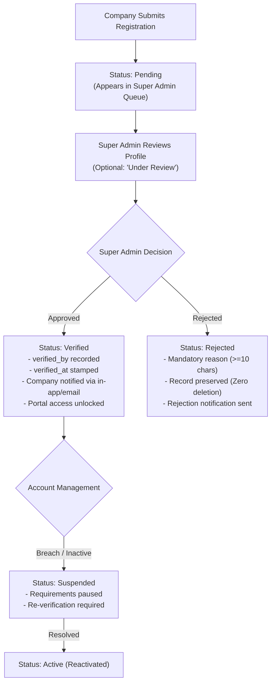

# Part 05 — Company Verification & Lifecycle Workflow
**PRAYAS — The Automation Academy**  
*Industry Manpower Requirement Portal*  
**Document Version:** 2.0  
**Phase:** Cycle 2.0 Modernization & Stabilization  

---

## 1. Overview & Verification Lifecycle

Industrial employers partnering with PRAYAS must complete formal institutional vetting before gaining access to candidate matching and requisition fulfillment.

---

## 2. Supported Status Taxonomy

The system strictly adheres to the database enum conventions defined in `companies.verification_status`:

| Status | Description | Employer Access Scope |
| :--- | :--- | :--- |
| `Pending` | Newly registered company awaiting review. | Can view profile; cannot submit requirements or view candidate pool. |
| `Under Review` | Company profile under active investigation or document clarification. | Can view profile and update requested information. |
| `Verified` | Formally approved by Super Admin. Legal CIN and HR credentials confirmed. | Full portal access: plant creation, team invitations, requirement creation. |
| `Active` | Active operational status equivalent to Verified. | Full portal access. |
| `Rejected` | Application turned down due to unverifiable credentials or invalid address. | Restricted access; record preserved in database with permanent audit rationale. |
| `Suspended` | Access temporarily halted due to policy violation or inactivity. | Hiring paused; company users cannot submit new demands. |

---

## 3. Decision Recording & Historical Traceability

When a decision is executed:
1. **Responsible Officer:** The authenticated Super Admin ID is recorded in `companies.verified_by = getUserId()`.
2. **Timestamp:** `companies.verified_at = NOW()` is updated.
3. **Rejection Rationale:** If rejected, `companies.rejection_reason` is updated with a mandatory, non-empty explanation (minimum 10 characters).
4. **Audit Trail:** A `COMPANY_STATUS_CHANGED` record is written to `audit_logs` capturing `old_status`, `new_status`, `rejection_reason`, and `approval_remarks`.
5. **Notification Dispatch:** The centralized `NotificationService::notifyCompanyAdmins()` dispatches in-app notifications and email alerts to the company contact.
6. **Non-Destructive Guarantee:** Rejections **never** delete company records; profiles remain in the database for auditing and potential re-application.

