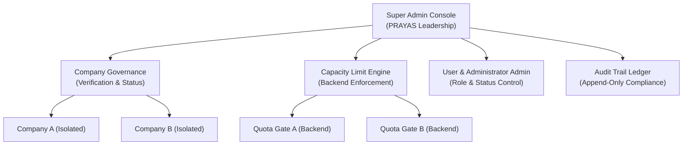

# Part 05 — Super Admin Governance Architecture
**PRAYAS — The Automation Academy**  
*Industry Manpower Requirement Portal*  
**Document Version:** 2.0  
**Phase:** Cycle 2.0 Modernization & Stabilization  

---

## 1. Architectural Scope & Governance Objectives

The Super Admin Governance Panel provides centralized platform administration for **PRAYAS – The Automation Academy**.

The Super Admin functions as the ultimate authority over:
1. **Institutional Governance:** Legal verification, vetting, activation, suspension, and reactivation of industrial employer profiles.
2. **Account Administration:** Provisioning, role assignment, password resets, and status management for Company Administrators, Recruiters, and Staff.
3. **Capacity Quota Allocation:** Backend-enforced quota limits (vacancies, requirements, company users, manufacturing plants).
4. **Compliance & Audit Ledger:** Real-time visibility into an append-only audit trail logging security and state mutations.
5. **Multi-Tenant Protection:** Enforcing absolute data isolation between different industrial companies while enabling cross-company governance for PRAYAS leadership.

---

## 2. Core Governance Modules

| Component Path | Functionality |
| :--- | :--- |
| `controllers/CompanyController.php` | Manages corporate listings, status transitions, company code formatting, verification remarks, and the company limits subsystem. |
| `controllers/UserController.php` | Governs user creation, company administrator assignment, status suspension/activation, and direct password resets. |
| `views/super_admin/dashboard.php` | Real-time governance dashboard featuring 8 database-backed summary cards, 4 functional sections, and quick action bars. |
| `views/super_admin/companies.php` | Complete Company Management directory with multi-criteria filtering, search, sorting, modal rejections, and CSV export. |
| `views/super_admin/company_details.php` | Comprehensive 6-tab company governance dossier covering basic info, contact info, verification history, administrators, limits, and audit logs. |
| `views/super_admin/company_limits.php` | Centralized Company Limits management console displaying assigned quotas, real-time usage progress, remaining capacities, and limit adjustment modals. |
| `views/super_admin/users.php` | User & Company Administrator management console with quick role-filter pills, status toggles, and direct password reset flows. |
| `views/super_admin/audit_logs.php` | Append-only audit log inspector with keyword search, user/company/action filtering, JSON payload inspect modals, and CSV export. |

---

## 3. Super Admin Dashboard Structure (Section 1)

The modernized Super Admin Dashboard displays 8 real database-backed summary metrics:

1. **Total Registered Companies:** `SELECT COUNT(*) FROM companies`
2. **Verified Companies:** `SELECT COUNT(*) FROM companies WHERE verification_status IN ('Verified', 'Active')`
3. **Pending Verification:** `SELECT COUNT(*) FROM companies WHERE verification_status = 'Pending'`
4. **Rejected Companies:** `SELECT COUNT(*) FROM companies WHERE verification_status = 'Rejected'`
5. **Suspended Companies:** `SELECT COUNT(*) FROM companies WHERE verification_status = 'Suspended'`
6. **Total Company Administrators:** `SELECT COUNT(*) FROM users u JOIN roles r ON u.role_id = r.id WHERE r.name = 'industry_admin'`
7. **Total Registered Users:** `SELECT COUNT(*) FROM users`
8. **Total Active Companies:** `SELECT COUNT(*) FROM companies WHERE verification_status IN ('Active', 'Verified')`

### Functional Dashboard Sections
- **Section A (Company Overview):** Tabbed interface highlighting Recently Registered, Recently Verified, Companies Awaiting Approval, and Suspended Companies.
- **Section B (Verification Overview):** Status distribution cards linking directly to pre-filtered company directories.
- **Section C (System Activity):** Two-column live feed showing recent administrative security audit events and newly provisioned user accounts.
- **Section D (Quick Actions):** One-click buttons to Add Company, Review Pending, Manage Companies, Manage Administrators, and View Audit Logs.

