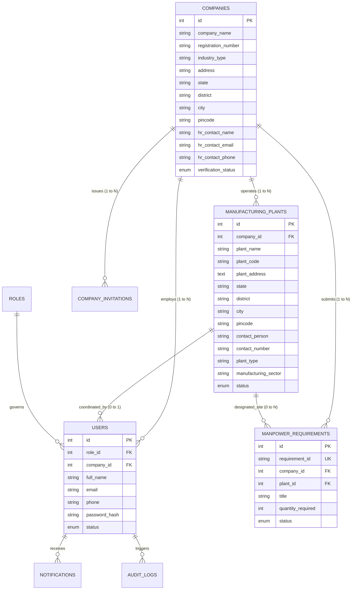

# Part 06 — Company, Industry & Manufacturing Plant Relationships
**PRAYAS — The Automation Academy**  
*Industry Manpower Requirement Portal*  
**Document Version:** 2.0  
**Phase:** Cycle 2.0 Modernization & Stabilization  

---

## 1. Physical & Logical Entity Relationships

The PRAYAS Manpower Portal manages a multi-tenant institutional hierarchy where corporate employers operate industrial facilities and designate local plant coordinators for student recruitment.



---

## 2. Multi-Tenant Hierarchy Architecture

```
                       SUPER ADMIN CONSOLE
                 (PRAYAS Institutional Leadership)
                                |
               +----------------+----------------+
               |                                 |
       COMPANY TENANT A                  COMPANY TENANT B
    (Tata Motors Passenger)            (Maruti Suzuki India)
               |                                 |
      INDUSTRY SECTOR:                  INDUSTRY SECTOR:
    Automotive Manufacturing          Automotive Manufacturing
               |                                 |
      +--------+--------+               +--------+--------+
      |                 |               |                 |
   PLANT 1           PLANT 2         PLANT 1           PLANT 2
 (Pune Bhosari)   (Sanand Unit)    (Manesar Plant)   (Gurgaon Plant)
      |                 |               |                 |
  COORDINATOR       COORDINATOR     COORDINATOR       COORDINATOR
   (User A1)         (User A2)       (User B1)         (User B2)
```

---

## 3. Storage Architecture Without Schema Mutations

To adhere strictly to **Database Safety Rules** and prevent any disruption to live database tables:
1. **Physical Facility Columns:** Core operational attributes (`plant_name`, `plant_code`, `plant_address`, `state`, `district`, `city`, `pincode`, `contact_person`, `contact_number`, `plant_type`, `manufacturing_sector`, `status`) are persisted directly into the base table `manufacturing_plants`.
2. **Extended Operational Metadata:** Granular operational attributes (`taluka`, `google_maps_url`, `departments`, `shifts_count`, `working_days_per_week`, `workforce_size`, `assigned_admin_user_id`) are persisted in the existing `system_settings` table under setting keys `plant_meta_{plant_id}`.
3. **User Designations & Granular Permissions:** User facility assignments and permissions are stored under setting keys `user_meta_{user_id}` and `user_perms_{user_id}`.
4. **Transparent Resolution:** `IndustryController::getPlants()` and `getPlantDetails()` automatically merge operational metadata seamlessly, exposing a unified data object to all views and consumers.

---

## 4. Proposed Migration 014 (Kept Strictly Unexecuted)

As required by project safety rules, a formal SQL migration script has been authored:
[`database/migrations/014_extend_manufacturing_plants_and_industries.sql`](file:///c:/Manpower%20Portal/database/migrations/014_extend_manufacturing_plants_and_industries.sql).

- **Scope:** Proposes an explicit `industries` table and adds operational columns directly to `manufacturing_plants`.
- **Status:** **PROPOSED — UNEXECUTED**. No tables were created or altered.
- **Rollback SQL:** Includes exact `DROP TABLE` and `DROP COLUMN` commands.
- **Zero Impact Guarantee:** The live portal operates 100% cleanly without executing this migration.

