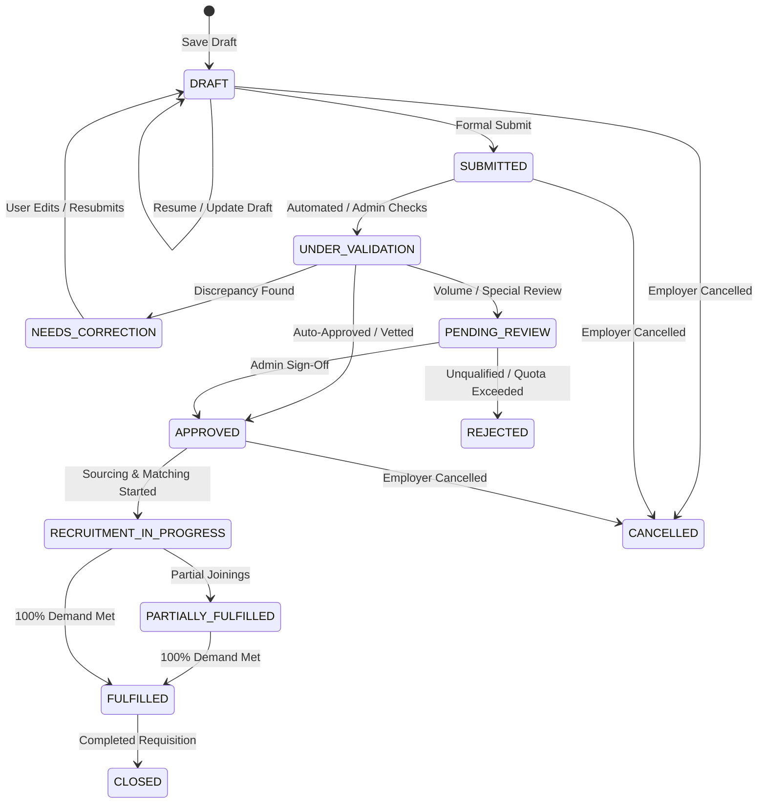

# Part 07 — Requirement Status Lifecycle & Workflow
**PRAYAS — The Automation Academy**  
*Industry Manpower Requirement Portal*  
**Document Version:** 1.0  
**Subsystem:** State Machine & History Ledger  

---

## 1. Lifecycle State Machine

The requirement lifecycle follows a deterministic finite state machine with strict transition rules:



---

## 2. State Descriptions

| State Code | UI Badge Class | Meaning |
|---|---|---|
| `DRAFT` | `badge-pending` | Work-in-progress requisition. Wizard progress is saved in `wizard_step`. Sourcing is inactive. |
| `SUBMITTED` | `badge-under-review` | Requisition completed and queued for validation pipeline. |
| `UNDER_VALIDATION` | `badge-under-review` | Running multi-point rule verification engine (`ALG-VAL-2026-V1.0`). |
| `NEEDS_CORRECTION` | `badge-rejected` | Evaluator identified errors (e.g. invalid dates, salary inversion) requiring industry revision. |
| `PENDING_REVIEW` | `badge-pending` | Routed to Super Admin review (high vacancy volume or special commercial terms). |
| `APPROVED` | `badge-approved` | Validated and approved for candidate matching and pipeline placement. |
| `RECRUITMENT_IN_PROGRESS` | `badge-in-progress` | Recruiters actively scheduling interviews and issuing call letters. |
| `PARTIALLY_FULFILLED` | `badge-partially-fulfilled` | A subset of demanded vacancies has reported to duty. |
| `FULFILLED` | `badge-fulfilled` | 100% of demanded technicians have joined the factory floor. |
| `CANCELLED` | `badge-closed` | Requisition cancelled by employer with mandatory reason. |
| `CLOSED` | `badge-closed` | Completed requisition officially archived. |

---

## 3. Immutable History Ledger (`requirement_status_history`)

Every state change must be accompanied by an entry in `requirement_status_history`:

```sql
INSERT INTO `requirement_status_history` 
(`requirement_id`, `previous_status`, `new_status`, `changed_by`, `remarks`, `created_at`) 
VALUES 
(:rid, :previous_status, :new_status, :user_id, :remarks, NOW());
```

The history log is exposed in the dossier view (`views/industry/requirement_details.php`) as an audit timeline showing timestamps, transitioning actors, and revision remarks.

