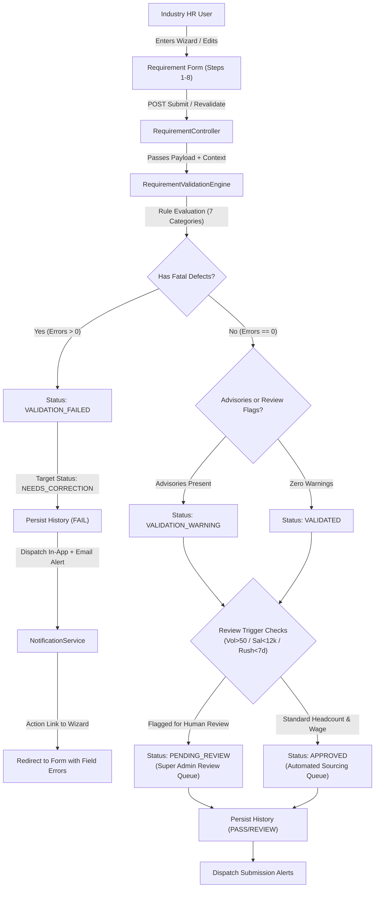

# Part 08 — Automatic Requirement Validation Engine Architecture

**Project:** PRAYAS – The Automation Academy | Industry Manpower Requirement Portal  
**Document Code:** `PRY-REBUILD-08-VAL-ENGINE`  
**Classification:** Core Application Engine Architecture  
**Version:** `ALG-VAL-2026-V1.0`  

---

## 1. Executive Overview

The **Automatic Requirement Validation Engine** (`includes/requirement_validation_engine.php`) is the centralized, deterministic, rule-based verification core of the PRAYAS portal. It acts as an automated quality gatekeeper that intercepts manpower requisitions during **Drafting**, **Submission**, **Manual Revalidation**, and **Background Audit**, inspecting requisition data against strict industrial, statutory, and logistical benchmarks before any ITI candidates are sourced or notified.

---

## 2. Core Architectural Objectives

1. **Deterministic Rule Evaluation:** Uniform execution of validation rules regardless of whether invoked via UI wizard, REST/POST controller, CLI cron, or unit test suite.
2. **Actionable Remediation Guidance:** Every single rule violation or advisory warning returns both an explanatory message and a concrete `suggested_correction` with the `current_value` detected.
3. **Multi-Tenant Boundary Enforcement:** Verification that plant facilities, user accounts, and candidate demand belong exclusively to the accredited employer company.
4. **Decoupling of Validation from Approval (`VALIDATED != APPROVED`):** An automated clean pass (`VALIDATED`) proves schema and logical compliance, but never bypasses the statutory human evaluation required for large batches (> 50 headcount), sub-benchmark wages (< ₹12,000), or expedited turnarounds (< 7 days).
5. **Zero Schema Mutation:** Full persistence into existing database tables (`requirement_validation_history`) utilizing structured JSON telemetry without modifying existing schemas.

---

## 3. Engine Invocation Lifecycle



---

## 4. Method Interface & Signature

The centralized engine exposes the following public API:

```php
public function validate(
    array $data,
    int $companyId,
    ?int $userId = null,
    ?int $existingReqId = null,
    bool $autoPersist = true,
    string $triggerType = 'SUBMISSION'
): array
```

### Return Contract
```php
[
    'is_valid'          => bool,              // true if zero fatal errors
    'validation_status' => string,            // 'VALIDATED' | 'VALIDATION_WARNING' | 'VALIDATION_FAILED'
    'target_status'     => string,            // 'APPROVED' | 'PENDING_REVIEW' | 'NEEDS_CORRECTION'
    'errors'            => array<string,string>, // Blocking defects by field name
    'warnings'          => array<string,string>, // Advisory suggestions
    'manual_reviews'    => array<string,string>, // Triggers requiring Super Admin signoff
    'rule_results'      => array<array>,      // Granular 25+ rule telemetry records
    'critical_issues'   => int,               // Count of critical blockers
    'categories'        => array<string,array>,// Category breakdown (passed, failed, warnings)
    'version'           => 'ALG-VAL-2026-V1.0',
    'run_id'            => string             // Unique deterministic run code: VAL-YYYYMMDD-HHMMSS-XXXX
]
```

---

## 5. Security & Isolation Assurances

1. **Cross-Company Isolation:** Rule `ERR-LOC-01` actively queries `manufacturing_plants` using both `id = :plant_id AND company_id = :company_id`. Even if a malicious request injects a foreign plant ID, the engine immediately flags an ownership violation.
2. **Account Suspension Gating:** Rule `BR-REG-003` halts processing if the employer's `verification_status` is `'Suspended'`.
3. **Statutory Age Compliance:** Rule `ERR-AGE-01` enforces `min_age >= 18` in strict compliance with the Indian Factories Act (1948) and Child Labour (Prohibition and Regulation) Act.

